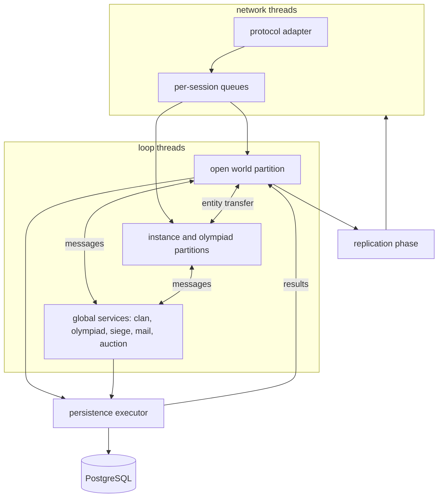

This page describes the architecture the nx-l2 game engine is moving towards: how the simulation runs, how game
objects are modelled, how state reaches clients and the database, and the order in which the imported L2J Mobius code
gets there. **It is the target being built, not what the server does today.** Today the server still runs the Mobius
threading model; the [migration path](#migration-path) below shows how it changes step by step.

The decisions were taken in [issue #18](https://github.com/l2nx/nx-l2/issues/18). The research behind them, covering
tick models, mature MMO server cores, ECS, spatial scaling and persistence, is on the
[engine research](/core/engine-research/) page.

## Principles

- **The client is the only fixed contract.** The protocol, the meaning of each packet and the measured behaviour of
  the client are given. How Mobius behaves on the server side is not a target to match: every mechanism is chosen on
  its merits.
- **One writer per piece of state.** Every piece of mutable game state has exactly one owning thread at a time. Game
  state has no locks and no concurrent collections.
- **Time and randomness are inputs.** Game code reads the clock and the random generator of its partition, never the
  system clock or a global random. A partition can then be replayed and tested.
- **Industry practice over invention.** The shape below is what authoritative online games converge on. Custom code
  is written only where Lineage 2 needs it.
- **Every step keeps a playable server.** The imported code is reworked in place, not rewritten from scratch.

## Overall flow



## Partitions

A partition is a simulation space behind a hard game seam. Entities in different partitions never interact directly,
so no locking or hand-off protocol between partitions is needed beyond moving an entity from one to the other.

- **The open world is one partition.** It is not split into regions. Splitting a seamless world across several
  writers is the approach that failed in practice, and Lineage 2 concentrates load on exactly the borders a split
  would create: sieges. If one thread ever proves insufficient, a parallel open world is the measured fallback.
- **Each instance and each olympiad match is a partition of its own.** These are separate spaces in the game
  already, so the seam costs nothing.
- **Global services** own state that spans partitions: clans and alliances, parties spread over several partitions,
  olympiad registration, castle ownership and siege schedule, mail, auction, world events. Each is a single writer
  with its own inbox. Partitions send commands ("player joins clan") and receive results; they read shared state such
  as clan names and castle owners from immutable snapshots the service publishes.
- **All partitions run in one process** on a pool of loop threads. A partition is executed by one thread at a time,
  and there is no global barrier, so a heavy partition does not delay the others.

## The partition loop

The loop described here is the [Zero-Tick Engine](/core/zero-tick-engine/); its page shows how it works, with
benchmarks and a comparison with other builds.

Each partition is an event loop, not a fixed-rate tick. It sleeps until the earliest of three things: a message in
its inbox, the next timer deadline, the next due periodic system.

- **Why not a fixed tick.** A tick of 100 ms or 50 ms adds up to one period of latency to every player action and
  rounds combat timing to the tick. In the loop a packet is processed in the pass right after it is decoded. Work
  that arrives within a few milliseconds is still batched into one pass.
- **Heavy work still runs on cadences.** Movement, visibility and AI do work for every entity regardless of input,
  so they run as periodic systems with their own intervals, expressed in time, never in ticks. No game logic counts
  ticks.
- **Packets of one client run strictly in arrival order.** Each session has its own queue; the partition takes
  sessions round-robin, with a per-pass limit, so a flooding client delays only itself. In Mobius two packets of one
  client could run concurrently or out of order, for example a trade confirmation against an item move. That class
  of race and duplication disappears.
- **Exact deadlines.** Timers live on one timer wheel per partition and carry absolute deadlines. A repeating action
  schedules its next run from its previous deadline, not from "now", so an attack every 333 ms stays 333 ms on
  average instead of drifting. Cancelling a timer is free: a stale entry is simply ignored when it fires.
- **No catch-up bursts.** A pass that runs late is followed by the next one as soon as possible; missed periodic runs
  are not replayed in a burst, which is how loops spiral under load.
- **Replayable.** A partition records its inputs, the random seed and the clock readings, so an incident can be
  replayed against the same build and turned into a test.

One pass runs in a fixed order: inbox, due deadlines, due periodic systems, deferred side effects, replication, and
one network flush per connection.

The clock distinguishes game time (cooldowns, casts, effects, movement) from wall-clock time (siege start, olympiad
periods, daily resets). Today both run at the same rate; the split keeps a future slowdown of an overloaded partition
a clock policy rather than a redesign.

## Entity model

- **Objects for scripts, composed of components.** `Player`, `Npc`, `Item` and the other entity classes stay as the
  facades scripts call. Behind each facade the state is split into components (movement, stats, status, effects,
  inventory, AI), each changed only by its system on the partition thread. The huge `Player` class shrinks into its
  components while its surface for scripts stays.
- **No ECS rewrite.** There is no public example of a classic MMO server core built on a pure entity-component
  system, the scripts (about 310 thousand lines) are written against object facades, and the measured gain needs
  data-oriented storage only on a few hot paths. Those paths, such as positions for visibility or combat stats in
  sieges, move to compact array storage behind their component only when the profiler points at them.
- **Handles, not references.** Entities refer to each other (target, attacker, summon owner, party members) by
  handle, resolved through the partition registry. A miss means the entity is gone. Dangling references after a
  despawn and accidental sharing between partitions are no longer possible.
- **Synchronous events, deferred side effects.** The existing event system for scripts stays and runs on the
  partition thread; there are no asynchronous events inside the process. Death, drops, rewards and experience are
  queued during a pass and executed in one place in a fixed order.

## Effects

Buffs, debuffs, toggles and periodic effects run on absolute deadlines on the partition timer wheel. A 20-minute buff
lasts exactly 20 minutes, not "20 minutes plus up to a second" as with a once-per-second scan. There is no task per
effect and no global scan. Applying twenty buffs marks the character's stats dirty once, so they are recalculated and
sent once per pass instead of twenty times, which matters most in sieges.

## Replication

Sending state to clients is a separate phase after the simulation. Simulation code never writes to sockets; it records
what happened as view events, and the replication phase routes them to the sessions that see the object.

- **The game knows no protocol.** It takes commands and emits view events through ports. A client protocol is an
  adapter that maps packets to commands and view events to packets, so supporting another client version adds
  mappers, not game code.

- **Exact client view.** Each session keeps the set of objects currently shown on its client, so a client can neither
  keep a phantom object nor miss one. Visibility is recomputed only for entities that crossed a grid cell; objects
  that stand still cost nothing.
- **Coalescing and budgets.** Several HP changes in one pass become one update. Events are classed as critical
  (always sent, in order), state (latest value per pass) and cosmetic (dropped first). A byte budget per connection,
  with priority for the player's target, party and attackers, keeps a siege with hundreds of players within network
  limits.

The movement engine already follows this model (time passed in, last intent kept, state changed only in its step) and
feeds the replication phase directly.

## Identity

| Kind          | What                              | Where it is used                               |
| ------------- | --------------------------------- | ---------------------------------------------- |
| Persistent id | UUIDv7                            | database, the platform, everything stored      |
| Wire handle   | 32-bit integer, allocated on load | packets, partition registry, entity references |

- **Why UUIDv7.** It is generated in the process, so an item can be created on the simulation thread (a drop, a
  craft) without a database round trip. It is unique across servers, so merging worlds or transferring characters
  copies rows without renumbering. It is time-ordered, so database inserts stay as cheap as with a sequence. The cost,
  16 bytes per key instead of 8, is negligible.
- **Why wire handles.** The protocol carries object ids as 32-bit integers in every supported chronicle, so a
  persistent id never goes on the wire. A handle is allocated when a character logs in or an NPC spawns, kept when the
  entity moves between partitions, and reused only after a quarantine of a few minutes, so a client still holding an
  old id cannot address a new object with it.

## Persistence

- **Value transfers are database transactions.** Trade, mail with attachments, warehouses, shops, auction and crafting
  run as one PostgreSQL transaction each. The items involved are locked in the game while it runs; the result returns
  to the partition, which applies or rolls back the change. Duplication through "one side saved, the other not, then a
  crash" is structurally impossible: there is a single save point.
- **Balance plus ledger.** Currency and stackable items keep a balance that cannot go negative, and every movement also
  writes an append-only ledger row in the same transaction. The ledger serves audit and lets a duplication be removed
  precisely instead of rolling the world back. Every operation carries an id, so a repeated request is not executed
  twice.
- **Everything else is written behind.** Position, experience, effects, skills and quest progress are tracked as dirty
  and written in batches about every 30 seconds. A crash loses at most that much progress, never values. Logout and
  shutdown save synchronously.
- **No database calls on game threads.** Queries run on a separate persistence executor; results come back through the
  inbox.

## Wiring and layout

- **Spring everywhere, with threading rules.** Data registries, systems, global services, handler registries and
  persistence services are Spring beans with constructor injection. Entities, components, events and messages are
  plain objects created by the engine. Inside partition and service code, Spring mechanisms that run code on other
  threads are not used: scheduling becomes partition deadlines, application events become game events, and database
  transactions run only on the persistence executor.
- **`engine/core` holds the runtime mechanisms** that do not depend on a chronicle: loops and timers, the clock,
  partitions, identity, sessions, replication and persistence. Game mechanics shared by chronicles move into `engine/`
  only when a second chronicle proves them identical.
- **Chronicle code is cut by feature,** not by technical layer: `combat`, `skill`, `effect`, `item`, `trade`, `clan`,
  `siege`, `olympiad` and so on. A slice owns its components and systems, its data, its commands and view events, its
  repositories, tables and settings. Catch-all packages such as `managers` and `util` dissolve into slices. See the
  [overview](/core/overview/) for the repository layout.

### Inside a slice

Every slice is a [Spring Modulith](https://spring.io/projects/spring-modulith) module with the same fixed layout. Its
root package is its API; the rest is internal unless marked as a named interface.

```
<slice>
  (root)       API: the facade, outbound ports, value types carried by commands and view events
  command/     commands and their handlers                       open to protocol adapters
  view/        view events and the read-only views mappers read   open to protocol adapters
  event/       domain events for systems and scripts             open to other slices
  system/      systems                                           internal
  model/       components and internal state                     internal
  template/    static data: templates, loader, registry          internal
  repository/  database access                                   internal
```

- **A protocol adapter reads only `view/`.** Components are mutable and owned by their system; the adapter sees view
  events and read-only views, so serializing a packet can never change game state.
- **Another slice is used only through its root API.**

### Ports

Ports exist only where the game meets a network or another process:

| Edge         | Into the game       | Out of the game         | Adapter                      |
| ------------ | ------------------- | ----------------------- | ---------------------------- |
| game client  | command and handler | view event, client port | client protocol (`highfive`) |
| login server | command and handler | login port              | the login link               |
| database     | —                   | repository              | the repository itself        |

Everything that enters the game is a command, whoever sends it, and has exactly one handler. An outbound port is an
interface named `<Edge>Port`. A repository is a plain class: there is one database and one implementation.

### Checked on every build

A test runs Spring Modulith's verification over the migrated slices (no cycles, no access to another slice's
internals) and ArchUnit rules for the layout: the fixed package names, where commands, handlers and events may live,
ports as interfaces only, no slice depending on the network layer. Rules the imported code still breaks are frozen:
the build fails on any new violation, and the list of old ones only shrinks.

## Migration path

The Mobius code is moved to this architecture in steps. Each step ships on its own, ends with a playable server and is
accepted by a bot load test that includes a siege; until the bots exist, by its metrics and play with a real client.
Scripts keep calling facades at every step.

| #   | Step                                                                                                |
| --- | --------------------------------------------------------------------------------------------------- |
| 0   | Bot load harness: headless clients with login, movement, PvE, PvP and siege scenarios               |
| 1   | Metrics: a baseline of the current execution first, then pass time per partition and phase          |
| 2   | Identity: UUIDv7 keys in the PostgreSQL schema, wire-handle allocator, with the PostgreSQL move     |
| 3   | Value transactions, ledger, operation ids, outbox                                                   |
| 4   | Database access off game threads, write-behind                                                      |
| 5   | Clock and random generator as inputs; monotonic game time                                           |
| 6   | The open world as a single writer: it drains the session queues, every world task goes to its inbox |
| 7   | Subsystems moved to partition deadlines one at a time: effects, combat, casting, AI, movement       |
| 8   | Replication phase; world state reaches clients as view events                                       |
| 9   | Global services; instances and olympiad matches as their own partitions                             |
| 10  | Packages reworked by feature slice, alongside steps 6 to 9; packets become commands and view events |
| 11  | Data-oriented storage on the hot paths the profiler shows                                           |

Step 6 carries the main risk: legacy code running on one thread may not fit the budget. The metrics of step 1 measure
it before step 6 lands, and an overrun is fixed by profiling, not by going back to shared thread pools.
