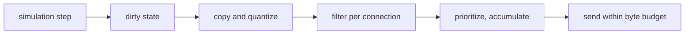

Before reshaping the engine, we studied how shipped online games run their server simulation: how time advances, how
the world is split across threads and machines, how state reaches clients and the database, and where things broke.
This page collects what the public sources say. Every claim links to its source; developer and vendor statements are
marked as such. Where no public source exists, the page says nothing.

## Execution models

### Fixed tick

The reference design of an authoritative server is the fixed tick. Valve describes the Source engine loop: during
each tick the server processes incoming user commands, runs a physics step, checks the game rules, updates object
state and then decides which clients need a snapshot
([Valve: Source Multiplayer Networking](https://developer.valvesoftware.com/wiki/Source_Multiplayer_Networking)).
Snapshots are delta-compressed against the last update the client acknowledged.

Tick rates span two orders of magnitude:

| Game                 | Tick           | Source                                                                          |
| -------------------- | -------------- | ------------------------------------------------------------------------------- |
| Old School RuneScape | 600 ms         | [OSRS Wiki: Game tick](https://oldschool.runescape.wiki/w/Game_tick)            |
| Minecraft            | 50 ms (20 TPS) | [spark: The tick loop](https://spark.lucko.me/docs/guides/The-tick-loop)        |
| Source games (TF2)   | 15 ms (66 Hz)  | [Valve](https://developer.valvesoftware.com/wiki/Source_Multiplayer_Networking) |
| Valorant             | 128 Hz         | [Riot Tech Blog](https://technology.riotgames.com/node/112)                     |

The difference that matters is not speed. In shooters the tick buys simulation precision. In MMOs and sandboxes the
tick becomes a **unit of game design**, and then it cannot change freely:

- **Valve** disabled the `-tickrate` option "because changing tickrate causes server timing issues"
  ([Valve](https://developer.valvesoftware.com/wiki/Source_Multiplayer_Networking)).
- **RuneScape** players turned tick edges into a skill of its own
  ([OSRS Wiki: Tick manipulation](https://oldschool.runescape.wiki/w/Tick_manipulation)).
- **World of Warcraft** processed actions between units in 400 ms batches until 2014, then "usually between 1ms and
  10ms later". WoW Classic deliberately brought the 400 ms window back to match the original gameplay
  ([wowisclassic.com](https://www.wowisclassic.com/en/news/spell-batching-classic-wow-confirmed/)), and a later
  Classic test realm moved to a 10 ms window
  ([wowisclassic.com](https://www.wowisclassic.com/en/news/spell-batching-impact-ptr/)).

When a tick takes longer than its budget, the next one simply starts late: Minecraft delays the next tick because
"ticks cannot execute in parallel" ([spark](https://spark.lucko.me/docs/guides/The-tick-loop)), and a busy RuneScape
world runs 0.616–0.618 s ticks instead of 0.6 s ([OSRS Wiki](https://oldschool.runescape.wiki/w/Game_tick)). The
opposite reflex, running extra steps to catch up, leads to the "spiral of death"
([Gaffer On Games: Fix Your Timestep](https://gafferongames.com/post/fix_your_timestep/)).

### CS2 sub-tick and exact deadlines

Counter-Strike 2 keeps a 64 Hz server, but the client stamps each input with its exact moment inside the tick and
the server evaluates the action at that moment. Valve's launch marketing said "tick rate no longer matters for moving,
shooting, or throwing"
([GameWorldObserver](https://gameworldobserver.com/2023/03/22/counter-strike-2-sub-tick-source-2-features-valve)). In
practice the system needed a series of timing patches
([dust2.us](https://dust2.us/news/41336/cs2-11-9-update-new-wave-of-fixes-for-sub-tick-and-audio-issues)), and in a
survey 14 of 37 professional players named sub-tick the biggest problem of the game
([dust2.us](https://dust2.us/news/63984/what-are-cs2s-biggest-issues-according-to-the-pros)). The reported symptoms,
such as inconsistent jump-throws ([Sportskeeda](https://sportskeeda.com/esports/even-64-tick-better-cs2-community-debates-sub-tick-system)),
come from a hybrid: some actions are timed exactly while the state they depend on still moves in 64 Hz steps. Valve
has not published the internals.

Client timestamps are not something a server should trust. The part that carries over is server-side: **keep the
exact due time of every event inside a coarse pass**. An attack, a cast end or an effect tick stores its deadline in
milliseconds; the pass runs every event that is due, in deadline order, and a periodic event is rescheduled from its
previous deadline rather than from the moment the pass happened to run. This is the same remainder-carrying idea as
the accumulator in [Fix Your Timestep](https://gafferongames.com/post/fix_your_timestep/), whose leftover time "is not
thrown away". Without it, timing quantizes to the tick: in RuneScape every action lands on a 600 ms boundary and a
request made mid-tick waits for the next one ([OSRS Wiki](https://oldschool.runescape.wiki/w/Game_tick)).

### Timers on shared pools and timer wheels

The standard structure for many pending timers is the timer wheel (Varghese and Lauck, SOSP 1987): constant-time
start, stop and per-tick bookkeeping ([the morning paper](https://blog.acolyer.org/2015/11/23/hashed-and-hierarchical-timing-wheels/)).
On the JVM it underlies Netty's `HashedWheelTimer`, Kafka and Agrona's
[`DeadlineTimerWheel`](https://www.javadoc.io/static/org.agrona/agrona/1.5.0/org/agrona/DeadlineTimerWheel.html).
A wheel is itself a tick with the slot width as its resolution, and events within one slot are not ordered by
deadline unless sorted.

The alternative, a timer per entity on a shared thread pool, scatters game logic over many threads. That only works
with locks around every shared object, and the order in which two timers touch the same target is not defined.

### Actor model

The best-documented use of actors in games is Microsoft Orleans behind Halo 4. Orleans ran the cloud services:
presence, statistics, and the turn-based Galactic Reign. The paper reports a lab test of 1 million actors at about
130,000 heartbeats per second on 25 servers. Combat authority stayed on the consoles, "because the ground truth is
always on the consoles" ([Microsoft Research: Orleans](https://www.microsoft.com/research/publication/orleans-distributed-virtual-actors-for-programmability-and-scalability/)).

An Orleans activation is single-threaded and runs in "turns", so each actor is a single writer. Combat is a poor
fit: one hit reads and writes several entities at once (attacker's mana, target's HP, aggro, area neighbours), and
with one actor per entity that becomes a message protocol between them. We found no public record of an actor-per-entity combat simulation at MMO scale.

The idea underneath both the game loop and actors is the single-writer principle from LMAX: "only one thing can ever
write to a single piece of data", which removes locks entirely
([Oracle Java Magazine reprint](https://developer.aliyun.com/article/26394)).

## How mature MMOs structure the server

**World of Warcraft emulators.** TrinityCore and AzerothCore are open source and show the full structure. One world
thread runs `World::Update(diff)`, a sequence of subsystems each measured with `METRIC_TIMER`, including packet
processing for all sessions. It then hands every map to a `MapUpdater` thread pool and waits on a barrier until all
maps are done ([AzerothCore World.cpp](https://github.com/azerothcore/azerothcore-wotlk/blob/master/src/server/game/World/World.cpp),
[MapUpdater.cpp](https://github.com/azerothcore/azerothcore-wotlk/blob/master/src/server/game/Maps/MapUpdater.cpp),
[TrinityCore MapManager.cpp](https://github.com/TrinityCore/TrinityCore/blob/master/src/server/game/Maps/MapManager.cpp)).
A map, a continent or an instance, is updated by one thread, so map logic needs no locks. Asynchronous database
results are applied on the world thread, and a synchronous query on the world or map thread is logged as a warning
([Main.cpp](https://github.com/azerothcore/azerothcore-wotlk/blob/master/src/server/apps/worldserver/Main.cpp)). The
weak point is the barrier: the slowest map sets the tick for all of them. AzerothCore's `MapMgr` cycles continents,
battlegrounds and dungeons over three steps to spread that load
([MapMgr.cpp](https://github.com/azerothcore/azerothcore-wotlk/blob/master/src/server/game/Maps/MapMgr.cpp)).
Retail WoW handles crowds with layering: each layer is a full copy of the world
([Wowhead](https://www.wowhead.com/news=294589/blizzard-clears-up-layering-tech-misconceptions-in-classic-wow)).

**EVE Online.** One shard, partitioned by solar system. Each node runs Stackless Python tasklets where "only one
tasklet can be running at any given time", and the Destiny physics updates once per second. When a node is
overloaded, CCP slows its game clock instead of letting it fall over: Time Dilation adjusts in fine steps so that the
tasklet queue stays near empty ([CCP: Introducing Time Dilation](https://www.eveonline.com/news/view/introducing-time-dilation-tidi)).
In the blog's 1,600-pilot example the fight ran at about 60% speed with 1,200 ships engaged. TiDi hit its 10% floor
in the Battle of Asakai and still degraded more gracefully than earlier battles
([Data Center Knowledge](https://datacenterknowledge.com/servers/experiencing-heavy-server-load-just-slow-down-time)).
The rule CCP gave for which timers dilate is worth copying as is: "if you look at your watch to see what time an
event is going to complete, it probably shouldn't be dilated". Reinforcement timers run on wall-clock time, shield
recharge on game time.

CCP's other habits are operational. Jita runs alone on its own node
([Tranquility Tech IV](https://www.eveonline.com/news/view/tranquility-tech-iv)), nodes are reserved for announced
large fights ([Fleet Fight Notification](https://www.eveonline.com/article/qd92g0)), and heavy work that is not
spatial moves off the simulation: Brain in a Box precomputes skill effects on a separate node instead of on every
jump ([forums archive](https://forums-archive.eveonline.com/topic/421522)), and Quasar moves serialization and routing
out of Python's GIL ([Introducing Quasar](https://www.eveonline.com/news/view/introducing-quasar)).

**Guild Wars 2.** Maps run as long-lived instance processes; the megaserver creates map copies on demand and places
players by party, guild, language and home world
([Engadget](https://www.engadget.com/2014-04-02-arenanet-rolls-out-the-megaserver-for-guild-wars-2.html)). Because
map instances stay up for weeks, a map-server crash is highly disruptive
([AWS for Games](https://aws.amazon.com/blogs/gametech/arenanet-guild-wars-mmorpg-migration)).

The pattern is the same everywhere: a unit of the world is simulated by one thread, parallelism comes from running
many such units, crowds are absorbed by copies where the design allows them or by slowing time where it does not, and
the database and non-spatial services stay off the simulation thread.

## Splitting a seamless world

Every partition above sits behind a **hard game seam**: a loading screen, a gate, a portal or a separate copy. A
TrinityCore map is a continent or an instance, not a region inside a continent; its grid of cells serves visibility
and unloading, not concurrency ([GridDefines.h](https://github.com/azerothcore/azerothcore-wotlk/blob/master/src/server/game/Grids/GridDefines.h)).
An EVE solar system meets its neighbours only through gates. Nothing interacts across those borders, so there is no
need for ghost copies, authority hand-off or distributed transactions.

Splitting continuous space is a different story:

- **SpatialOS.** Improbable's runtime split the world among workers, each seeing a partial view. Its load balancer
  needed a dedicated fix for "entities moving back and forth across different worker regions"
  ([Improbable](https://ims.improbable.io/insights/spatialos-runtime-update-2-new-load-balancing-system/)). Worlds
  Adrift, Mavericks and Lazarus were cancelled in a row
  ([PCGamesInsider](https://www.pcgamesinsider.biz/news/69519/ambitious-visionary-products-always-contain-some-risk-says-improbable-after-third-spatialos-project-bites-the-dust/)),
  though Bossa did not blame the platform for Worlds Adrift
  ([PCGamesInsider](https://www.pcgamesinsider.biz/news/69671/bossa-doesnt-blame-improbable-for-worlds-adrifts-cancellation/)).
  Improbable sold its multiplayer services studio in 2023 ([CNBC](https://www.cnbc.com/2023/12/18/metaverse-firm-improbable-sells-gaming-unit-for-97-million.html)).
- **New World.** Amazon's own blog describes a static grid: seven hub processes per world, each owning two
  non-adjacent cells, behind four gateway instances that are the only public addresses, with player state passing
  from hub to hub as players move
  ([AWS for Games](https://aws.amazon.com/blogs/gametech/the-unique-architecture-behind-amazon-games-seamless-mmo-new-world);
  vendor blog). The hand-off protocol is not published.
- **Star Citizen.** CIG moved world state out of game servers into a replication layer
  ([Star Citizen Wiki](https://starcitizen.tools/Replication_layer)) and shipped static server meshing in Alpha 4.0
  at 500 players per shard ([Star Citizen Wiki](https://starcitizen.tools/Server_meshing)). In early 2026 the CTO
  reported 600–800 per shard; dynamic meshing was still in internal testing, and the open issues included items lost
  during backend slowdowns ([StarShipDealers recap](https://www.starshipdealers.com/blog/sc-live-tech-talk-server-meshing-2026/),
  [Massively OP](https://massivelyop.com/2026/02/06/star-citizen-cto-outlines-progress-on-server-meshing-and-crafting-with-alpha-4-7-on-track-for-march/);
  developer statements).
- **Ashes of Creation.** "Dynamic gridding" was shown in 2024 and tested in 2025
  ([Mein-MMO](https://mein-mmo.de/ashes-of-creation-fortschritte-juli-2025-alpha-staedte/); developer claims relayed
  by press). The studio shut down in early 2026 ([Wikipedia](https://en.wikipedia.org/wiki/Ashes_of_Creation)).

The closest precedent on the JVM is **Folia**, PaperMC's Minecraft server. It groups nearby chunks into regions that
tick in parallel, merge and split at runtime, with "no main thread"
([Folia region logic](https://docs.papermc.io/folia/reference/region-logic)). It works, and its README is candid
about the price: "I expect _every_ single plugin that exists to require _some_ level of modification"; global
scoreboards are broken, teleport became asynchronous, the scheduler was replaced by four. It targets servers whose
players spread across the map and recommends at least 16 physical cores
([Folia README](https://github.com/PaperMC/Folia)).

Lineage 2 has the opposite load profile: players concentrate exactly where a regional split would draw its borders,
at sieges and raid bosses. As of 2026, the public record has no live MMO that splits continuous space dynamically
and holds up, and the systems that split it statically paid in hand-off problems and lost items.

## ECS on servers

**Overwatch** is the canonical shipped example of a strict entity-component-system in an authoritative game
([GDC Vault](https://www.gdcvault.com/play/1024001/-Overwatch-Gameplay-Architecture-and)). According to a secondary
summary of the talk, the gains were structural: entities are IDs, components are data, systems hold no state,
gameplay netcode sits in three systems, and side effects are deferred to one call site per frame. Settling the rules
reportedly took about 1.5 years, and code that broke them was the main source of bugs
([Edgegap](https://edgegap.com/blog/game-backend-deep-dive-overwatch-2016-netcode-architecture-rollback)).

ECS is mainstream in engines: **Unity DOTS** with Netcode for Entities
([Unity docs](https://docs.unity3d.com/Packages/com.unity.netcode@1.8/manual/ghost-snapshots)), **Unreal Mass**,
which lives beside the Actor world rather than replacing it
([Epic docs](https://dev.epicgames.com/documentation/unreal-engine/overview-of-mass-entity-in-unreal-engine)), and
**Flecs** and EnTT in shipped titles ([ECS FAQ](https://github.com/SanderMertens/ecs-faq)).

The limits are documented by the ECS authors themselves. The FAQ maintained by the Flecs author says spatial indexes
usually live outside the ECS, hierarchies through component links slow iteration, and ECS rules "conflict with OOP
intuition" ([ECS FAQ](https://github.com/SanderMertens/ecs-faq)). Many relationships or toggled tags fragment entities
across tables ([Flecs Relationships](https://www.flecs.dev/flecs/Relationships.html)). The Artemis author notes that
for a couple of hundred entities the framework choice "probably doesn't matter"
([Artemis wiki](<https://github.com/junkdog/artemis-odb/wiki/Artemis-vs-Ashley:-(Don't)-Fight!>)). We found no
public postmortem of an MMO with RPG-style skills and effects built on a full ECS, and no independent benchmark of ECS
against objects at MMO entity counts.

Hytale is a cautionary data point. In 2024 the team announced a C++ rewrite with Flecs at its core
([Hytale](https://hytale.com/news/2024/6/summer-2024-technical-explainer-hytale-s-entity-component-system-opwpcamdi)).
According to secondary sources, the game entered early access in 2026 on its legacy Java server instead
([Winternode](https://winternode.com/blog/hytale/hytale-server-hosting-guide)).

**State on the JVM.** The Java ECS libraries Artemis and Dominion are listed as inactive
([ECS FAQ](https://github.com/SanderMertens/ecs-faq)). Value classes (JEP 401) are integrated in JDK 28 as a preview
feature only ([JEP 401](https://openjdk.org/jeps/401)), so in 2026 compact data layouts mean primitive arrays and
primitive collections. Generational ZGC is the default ZGC mode since JDK 23, with sub-millisecond pause targets
([JEP 474](https://mail.openjdk.org/pipermail/jdk-dev/2024-May/008902.html)); allocation on hot paths still costs
time.

## Replication as a separate phase

Current engines run replication as its own pipeline after the simulation step. Unreal's Iris tracks a dirty bitfield
per replicated state; before sending it copies and quantizes dirty state, then filters by owner, connection, group or
a custom spatial rule, then prioritizes. Priority accumulates across ticks until an object is sent, so low-priority
objects still go out eventually, and sending respects a per-connection budget
([Components of Iris](https://dev.epicgames.com/documentation/unreal-engine/components-of-iris-in-unreal-engine),
[Iris filtering](https://dev.epicgames.com/documentation/en-us/unreal-engine/iris-filtering-in-unreal-engine),
[Iris prioritization](https://dev.epicgames.com/documentation/unreal-engine/iris-prioritization-in-unreal-engine)).

Its predecessor, Replication Graph, was built for Fortnite: a 2D grid node keeps per cell the actors visible from it,
so a client copies its cell's list instead of checking the distance to every actor
([Epic tech blog](https://www.unrealengine.com/tech-blog/replication-graph-overview-and-proper-replication-methods),
[Epic docs](https://dev.epicgames.com/documentation/en-us/unreal-engine/replication-graph-in-unreal-engine)).

A separate phase can later become a separate service: Star Citizen's replication layer and New World's gateway
instances are that step. For a crowded fight the dominant cost is telling everyone about everyone's movement, skills
and effects, which is a replication problem, not a simulation one.

## Persistence and economy integrity

In mature systems the database is not part of the tick. Authoritative state lives in memory and is written
asynchronously or periodically. TrinityCore saves a player every 90 s (`PlayerSaveInterval = 90000`) and on logout,
through an asynchronous database worker
([worldserver.conf.dist](https://raw.githubusercontent.com/TrinityCore/TrinityCore/master/src/server/worldserver/worldserver.conf.dist)).
EVE's database serves "primarily for storage"
([Tranquility Tech IV](https://www.eveonline.com/news/view/tranquility-tech-iv)). Veloren polls its character loader
and updater once per server tick ([Veloren docs](https://docs.veloren.net/veloren_server/persistence/character/index.html)).
Because memory is the source of truth, manual database edits to an online character's inventory are not picked up or
get overwritten ([TrinityCore forum](https://talk.trinitycore.org/t/inserting-bags-into-bag-slots/30918)).

The publicly documented duplication incidents share one cause: **a transfer between two players saved at two
separate points**.

- **RuneScape, 2020.** Player A gives items to B, B logs out and is saved, then the server is made to crash. Players
  roll back to their save "from either 15 minutes ago, or their last logout", so A gets the items back and B keeps them
  ([RuneScape Wiki](https://runescape.wiki/w/Server_crash_glitch)).
- **New World, 2021.** Characters hit by a persistence failure sent gold, logged out, and only the recipient's side
  was saved ([PCGamesN](https://www.pcgamesn.com/new-world/gold-duping-bug)). A separate exploit refunded the cost of a
  town upgrade that never started ([Mein-MMO](https://mein-mmo.de/new-world-gold-exploit-schon-wieder/)). Amazon
  disabled all wealth transfers while fixing it ([WePC](https://www.wepc.com/gaming/new-world/players-discover-new-world-gold-exploit-causing-gold-dupes/)).
- **Diablo IV, 2025.** Starting a trade and quitting the client left items with both players; Blizzard suspended
  trading ([Shacknews](https://shacknews.com/article/136657/diablo-4-player-trading-suspended-duplicate-exploit)).
- **Order & Chaos.** Repeatedly pressing "extract all" in the mail gave several copies, a missing-idempotency case
  ([DroidGamers](https://www.droidgamers.com/news/gamelofts-mmorpg-order-and-chaos-hit-with-more-problems-this-time-of-the-item-duping-kind/)).

Item identity is a failure point of its own. In 2010 a script that reused the IDs of deleted items failed in EVE;
new items got no ID, inventories broke and up to 114,000 item IDs were affected
([CCP](https://www.eveonline.com/news/view/extended-downtime-friday-07-may-due-to-database-problems-some-ingame-items-affected)).
When a dupe gets out, the fallback is a world rollback that costs every player their recent progress
([OSRS Wiki: Rollback](https://oldschool.runescape.wiki/w/Rollback)).

The remedies follow from the incidents. A transfer of value is **one database transaction** covering both sides,
confirmed to the player only after it commits; McGill's work on MMO persistence likewise says "critical events must
be written synchronously" ([Kemme et al., NetGames 2008](https://cs.mcgill.ca/~kemme/papers/netgames08-persistence.html)).
Items keep an immutable identity that is never reused. Every operation that can be retried (a mail claim, a purchase)
carries an operation id so it applies once. An append-only ledger of value movements makes it possible to remove
duplicated goods precisely instead of rolling the world back. Ordinary state such as HP, position or experience can
go through write-behind, where only the latest value per key within a window is written
([Hazelcast MapStore](https://docs.hazelcast.com/hazelcast/5.5/mapstore/configuration-guide)); coalescing is safe
for state, never for transfers.

## Degradation and replay need the same thing

Time Dilation only works because EVE's game logic reads a game clock rather than the system clock. Deterministic
replay needs the same: Factorio finds a divergence by comparing a CRC of the whole map every tick while replaying a
save, and the difference is usually "a value of one variable"
([Factorio FFF #47](https://factorio.com/blog/post/fff-47)). Determinism is fragile: a 2024 desync could be
reproduced only by simulating a different CPU core count ([FFF #415](https://direct.factorio.com/blog/post/fff-415)),
and parallel systems without a fixed order are exactly the "execution order ambiguities" that Bevy reports
([bevy_ecs](https://docs.rs/bevy_ecs)). An authoritative server does not need lockstep across clients, but if one
partition runs on one thread and reads time and randomness only through injected sources, its input log is enough to
re-run it.

Overload has to be measured before it is handled. Spark, the Minecraft profiler, treats less than 5% idle time per
tick as lagging and warns that averages hide 300 ms spikes
([spark](https://spark.lucko.me/docs/guides/The-tick-loop)); AzerothCore times every subsystem of its world update
([World.cpp](https://github.com/azerothcore/azerothcore-wotlk/blob/master/src/server/game/World/World.cpp)).

## What nx-l2 takes from this

The [architecture](/l2/architecture/) page describes the result. In short:

- **One writer per partition, partitions behind hard seams.** The open world is one partition; each instance and
  olympiad match is another. The contiguous world is not split into regions, because that is where Lineage 2 crowds
  gather and where split worlds broke.
- **No global barrier.** Partitions run independently, so a heavy one does not hold up the rest.
- **Exact deadlines, not a coarse global tick.** Attacks, casts and effects keep their exact due time and periodic
  work carries its remainder; timers move off the shared thread pool of the imported code into the owning partition.
- **Injected time and randomness**, classified per mechanic as game time or wall-clock time, so that time dilation and
  replay remain possible.
- **Objects stay as the facade scripts call**, composed of parts; data-oriented storage only where profiling shows a
  hot path. No ECS rewrite.
- **Replication as its own phase** after the simulation, with per-connection budgets.
- **The database off game threads**, write-behind for ordinary state, one transaction plus a ledger for every
  transfer of value, and persistent item identities that are never reused.
- **Measure first.** Pass time per partition and subsystem, and bot load tests that include a siege scenario.
- **Our movement engine** runs inside the same partition model as the rest of the simulation.
