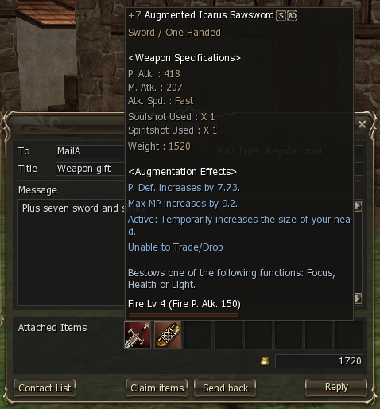
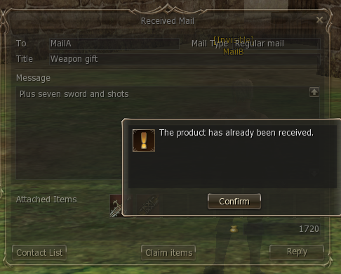
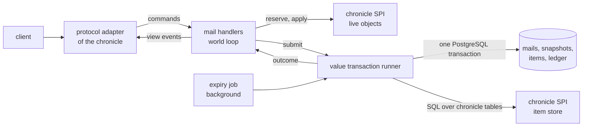
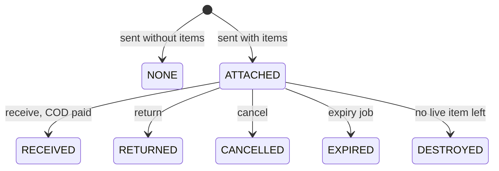

The postbox of the L2NX engine, a module shared by every chronicle with a postbox and built on value transactions: every move of items or adena is one ACID transaction with an
idempotency key, and every letter keeps an immutable snapshot of its attachments.

**Status:** the engine module `engine/mail`, live in the High Five chronicle (Essence follows with its own defaults),
and the first consumer of value transactions; trade, warehouses and stores follow.

## Game functions

The retail postbox: letters with up to `max-attachments` items and optional cash on delivery, inbox and sent
box, receive, return, cancel, delete, expiry, system and birthday mail.

## Attachment history

At send, each attachment is captured into an immutable item snapshot: template, count, enchant, custom types, mana and
time limit, augmentation, attack and defence elements, enchant options. The snapshot is written once in the send
transaction and never updated; the live item moves independently on receive, return, cancel or expiry.

- Received and sent mail always render attachments from snapshots, settled or not.
- The client keeps Receive (Cancel in the sent copy) on a settled letter; Receive answers system message 3382 ("The
  product has already been received."), Cancel answers 3030 ("You cannot cancel sent mail since the recipient received
  it.").
- A returned letter gets copies of the original's snapshot rows.
- Deletion and expiry only hide a letter; the letter, its snapshots and its ledger rows are kept.






## Benefits

### Atomic, exactly-once moves

Send, receive, return, cancel and expiry are each one ACID transaction over the letter, the items, the adena and the
ledger: a crash before the commit changes nothing. Every transaction carries an idempotency key, so a retry is
exactly-once: a repeated key replays the recorded result instead of executing again.


### Conditional updates instead of locks

Every transition out of `ATTACHED` is a conditional update (`WHERE attachments = 'ATTACHED'`), optimistic concurrency
on the letter row: of a receive, a cancel and an expiry racing on one letter, exactly one commits.


### Append-only history

Deletion and expiry only hide a letter; letters, snapshots and the value ledger are never deleted. A duplication found
later is traced and removed from the ledger instead of a world rollback.

### Configuration

Fees, lifetimes, mailbox size, attachment count, send interval and the zone, combat and death rules are
`l2nx.mail.*` settings with retail defaults.

### Offline participants

Receivers, cash-on-delivery payees and expiry owners need not be online: their rows change by delta in the same
transaction.

### Shared module

`engine/mail` serves every chronicle with a postbox through an SPI; a new chronicle adds its protocol mappers and its
own snapshot fields.

## Comparison with other builds

| Feature                                   | L2NX | L2J Mobius | aCis | L2J Server | L2-Scripts line | Non-Java rewrites |
| ----------------------------------------- | :--: | :--------: | :--: | :--------: | :-------------: | :---------------: |
| Attachment snapshots after receive        |  ✓   |     ✗      |  —   |     ✗      |        ✗        |         ✗         |
| Atomic send and receive (one transaction) |  ✓   |     ✗      |  —   |     ✗      |        ✗        |         ✗         |
| Idempotent retries                        |  ✓   |     ✗      |  —   |     ✗      |        ✗        |         ✗         |
| History kept after deletion and expiry    |  ✓   |     ✗      |  —   |     ✗      |        ✗        |         ✗         |

From the public source of each family, High Five lines; ✓ yes, ✗ no, — no postbox (aCis is Interlude, which has no
postbox). Non-Java rewrites: lineage2ts (TypeScript, High Five); the Elixir, C# and Python rewrites are Interlude.
Facts per cell: [detailed comparison](#detailed-comparison).

## How it works

### Module

`engine/mail` owns its tables, commands, view events, settings and the expiry job, and depends on no chronicle. The
chronicle SPI has two sides:

- **World loop, live objects:** mailable items, reservation of items and fee, room for incoming items, applying a
  committed move to memory, participant state (peace zone, combat, trade, jail).
- **Transaction, chronicle tables:** receiver lookup, block list, item row moves, adena on both sides. The module never
  writes a chronicle table.



The database is the source of truth; no letter is cached. Lists and open letters are read-only queries off the world
loop. Mail is not a global service: the letter row serializes concurrent changes, so an in-memory single writer
would add only a cache to keep consistent with offline writes.

### Value transactions

Each move (send, receive, return, cancel, expiry, character deletion) is one PostgreSQL transaction that updates the
letter, the items and the adena and appends one value-ledger row per movement.

1. The handler validates on the world loop and sets **pending marks** on the reserved items and adena; container
   mutations reject marked items on every path, scripts included.
2. The runner executes the transaction on the persistence executor.
3. The outcome returns to the loop, which applies the commit to memory and clears the marks.

```mermaid
sequenceDiagram
  participant P as player
  participant L as world loop
  participant R as transaction runner
  participant D as PostgreSQL
  P->>L: Receive
  L->>D: read letter and snapshot (off the loop)
  L->>L: validate, reserve, pending marks
  L->>R: submit(idempotency key)
  R->>D: claim key; UPDATE ... WHERE ATTACHED;<br/>move items; pay COD; ledger; COMMIT
  R-->>L: Committed
  L->>L: apply to memory, clear marks
  L-->>P: items, system messages
```

**Idempotency key.** A UUIDv7 created by the world per player action; scripts and the platform pass their own (the
birthday gift derives it from character and year). The runner claims the key first under a unique constraint, so a
concurrent duplicate blocks on the first and then replays it.

**Outcomes.**

| Outcome     | Meaning                                                | Loop action                       |
| ----------- | ------------------------------------------------------ | --------------------------------- |
| `Committed` | committed                                              | apply, clear marks                |
| `Replayed`  | key already committed; its ledger rows are returned    | apply the committed rows          |
| `Refused`   | a condition failed inside the transaction; rolled back | clear marks, report the reason    |
| `Failed`    | error before commit; rolled back                       | clear marks, report failure       |
| `Unknown`   | connection lost around the commit; outcome unknown     | keep marks, resolve by key lookup |

**Resolving `Unknown`.** The lookup claims the key itself under a short lock timeout: it blocks on a transaction still
committing, conflicts if it committed (`Replayed`), otherwise succeeds and is rolled back, which fences the original
(`Failed`). A timeout is `Unknown` again; lookups back off 1, 5, 30, then 60 s. Marks stay until resolved, so a save
cannot overwrite moved rows.

Isolation is `READ COMMITTED`: a conditional update racing a committed one re-evaluates the row instead of failing to
serialize. Commits are synchronous. Meter: `l2nx.value.transaction` (timer, tags `type`, `outcome`).

### Online and offline sides

- **Online:** the partition owns the items and the database lags until the next save; the transaction writes absolute
  state from memory under an owner condition, the ledger records the delta.
- **Offline:** rows change by delta under `CHECK (count >= 0)`, merging into an existing stack or inserting one.

While a transaction is in flight, the character's reserved items are excluded from saves and world entry and logout
wait for the outcome, so neither a pre-commit save nor a login races the commit.

### Item snapshot

Written once per slot into `mail_attachments` at send, never updated:

| Field                          | Content                                    |
| ------------------------------ | ------------------------------------------ |
| `item_template_id`, `count`    | template, count                            |
| `enchant_level`                | enchant                                    |
| `custom_type1`, `custom_type2` | custom types                               |
| `mana_left`, `item_expires_at` | shadow item mana, time-limited item expiry |
| `augmentation_option1`, `…2`   | augmentation                               |
| `attack_element`, `…_power`    | attack element and power                   |
| `fire` … `dark`                | defence elements                           |
| `enchant_option1` … `3`        | enchant options                            |

Live items stay item rows with location `MAIL` and the letter id and are never loaded into memory. Chronicle-specific
fields go to a chronicle table keyed by `(mail_id, slot)`; High Five has none. A mail attachment is the snapshot plus
the live item while it is in the letter.

### States



- Every transition out of `ATTACHED` is `UPDATE … WHERE attachments = 'ATTACHED'`; of concurrent transitions exactly
  one matches.
- **Return** creates a new letter to the sender (`returned_from_id`, same type, no COD, own expiry); live items move to
  it, its snapshot rows are copies; the original stays `RETURNED`.
- **Destroyed:** a receive with no live item left settles without charging COD; character deletion destroys
  unreceivable attachments and records them in the ledger.
- A side may delete a letter only once it is no longer `ATTACHED`.

### Mail types

| Type       | Sender shown by the client   | Return, reply |
| ---------- | ---------------------------- | ------------- |
| `PLAYER`   | the player                   | yes           |
| `SYSTEM`   | the client's system sender   | no            |
| `BIRTHDAY` | the client's birthday sender | no            |

Wire values are protocol code of the chronicle adapter.

### History

Letters and snapshot rows are never deleted. A letter keeps sender and receiver names captured at send, the send, read
and settle timestamps, the final state, and the per-side deletion and expiry timestamps. The value ledger keeps every
movement with its transaction: holder (inventory, warehouse or mail), item, template, delta.

### Settings

`l2nx.mail.*` in `config/application.yaml` ([operations](/core/operations/)); defaults are the retail values; a chronicle overrides what differs.

| Key                           | Default | Meaning                                                                 |
| ----------------------------- | ------- | ----------------------------------------------------------------------- |
| `enabled`                     | `true`  | postbox enabled                                                         |
| `attachments.enabled`         | `true`  | items and cash on delivery                                              |
| `attachments.peace-zone-only` | `true`  | attachment actions (send, receive, return, cancel) only in a peace zone |
| `attachments.deny-in-combat`  | `false` | attachment actions refused in combat                                    |
| `attachments.deny-when-dead`  | `false` | attachment actions refused while dead                                   |
| `fee.base`                    | `100`   | adena per letter                                                        |
| `fee.per-attachment`          | `1000`  | adena per attachment                                                    |
| `max-attachments`             | `8`     | attachments per letter, 1–8 (the client shows 8 slots)                  |
| `mailbox-limit`               | `240`   | visible letters per box                                                 |
| `expiry`                      | `360h`  | letter lifetime                                                         |
| `cod-expiry`                  | `12h`   | lifetime of a letter with cash on delivery                              |
| `send-interval`               | `10s`   | minimum interval between sends of a character; `0s` disables it         |
| `expiry-poll`                 | `1m`    | expiry job cadence                                                      |

The send interval is a per-character Bucket4j bucket.

### Protocol 267 (High Five client)

- **Attachments are rendered from snapshots** with synthetic object ids `slot + 1`. Live object ids start at
  `0x10000000`, so the ranges never collide; the client never sends attachment ids back, every request names only the
  letter.
- **Letter ids on the wire** are session-local numbers mapped to UUIDs (at most 480 entries for both boxes); mail
  takes nothing from the world's id allocator.
- **Flags:** `WithItem` only while `ATTACHED`, `Trade` only while COD is unpaid, `ReturnAble` only for an unsettled,
  non-returned `PLAYER` letter.
- **Subjects** are truncated to 96 characters in the lists so a full box of 240 fits one frame (65535 bytes); the
  opened letter carries the full subject.

## Detailed comparison

| Family          | Attachment storage                                                   | After receive                                            | Persistence                                                                                                   | Retries         | Deletion and expiry               |
| --------------- | -------------------------------------------------------------------- | -------------------------------------------------------- | ------------------------------------------------------------------------------------------------------------- | --------------- | --------------------------------- |
| L2NX            | live item rows (`MAIL`) plus a snapshot row per slot                 | snapshot kept and rendered                               | one ACID transaction: letter, items, adena, ledger                                                            | idempotency key | rows kept, hidden with timestamps |
| L2J Mobius      | live item rows (`MAIL`, message id)                                  | `transferItem`, then `removeAttachments`: no items shown | separate writes, no SQL transaction; an offline sender's COD is a new adena item saved on its own             | none            | `DELETE FROM messages`            |
| L2J Server      | same model (`Message`, `MailManager`)                                | same                                                     | separate writes, no SQL transaction                                                                           | none            | `DELETE FROM messages`            |
| L2-Scripts line | link table `mail_attachments (message_id, item_id)` to the live item | links cleared; a letter without body is deleted          | in-memory changes under `synchronized`, persisted separately; an offline sender is paid through delayed items | none            | `DELETE FROM mail`                |
| lineage2ts      | item container per letter                                            | `removeAttachments`                                      | in-memory changes; letters persisted on a 15 s debounce, items by their own cache                             | none            | `DELETE FROM mail_messages`       |
| aCis            | no postbox (Interlude)                                               | —                                                        | —                                                                                                             | —               | —                                 |

None of these public trees keeps attachment snapshots, runs a send or receive as one transaction, or makes mail
actions idempotent.

## Limits

- **Receive stays visible on a settled letter.** Protocol 267 has no "already received" flag; the client shows Receive
  (Cancel in the sent copy) whenever items are listed, and the server answers 3382 / 3030. A client patch hiding both
  buttons is deferred.
- **Subjects are truncated to 96 characters in the lists** (frame size limit); the opened letter is complete.
- **Platform events come with the adapter:** each committed mail transaction will publish an event with the moved
  snapshots through a transactional outbox, which arrives with the L2NX platform adapter
  ([#13](https://github.com/l2nx/nx-l2/issues/13)).
- **Mail is the first consumer:** trade, warehouses and private stores still use the legacy save path.

## Read more

- [Architecture](/core/architecture/#persistence): partitions, persistence and value transactions.
- [Zero-Tick Engine](/core/zero-tick-engine/): the world loop the mail handlers run on.
- [Glossary](/core/glossary/#mail): mail, mail attachment, item snapshot, value transaction and related terms.
