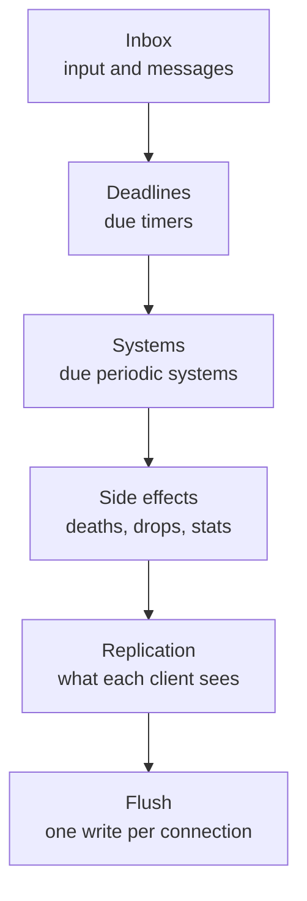

## A world that doesn't tick. It reacts.

Every player action, every hit and every buff is handled the moment it happens: no ticks, no races, no idle work.


**Status:** the engine core is in nx-l2 today, and the world moves onto it step by step. See the
[migration path](/core/architecture/#migration-path).

## Why Zero-Tick

### Faster

Timers, buffs and cooldowns cost several times less than in classic builds.

### No dupes

An item can't end up in two places: inventory changes happen one at a time, on the space's own thread.


### No races

A hit and a Sleep that land at the same moment always resolve the same way, in arrival order. An attack wakes a
sleeping target, so the order decides the fight.


### Instant reaction

Nothing waits for "the next tick": an action is handled right away.

### No idle work

Every wake-up is a real event: no empty beats like tick builds, no tasks spinning on empty pools like pool
builds.

### See everything

Where it slows down, in which phase, in which pass: Prometheus metrics out of the box, ready for your Grafana.

### Deterministic by design

A pass is deterministic: time and randomness come only from the pass, and the seed is logged, so the same inputs give the same fight. Recording live inputs for replay is on the roadmap.

## Zero-Tick vs classic builds

| Feature                              | Zero-Tick | L2J Mobius | aCis | L2J Server | L2-Scripts line | L2E (Elixir) |
| ------------------------------------ | :-------: | :--------: | :--: | :--------: | :-------------: | :----------: |
| Wakes only on events, no polling     |     ✓     |     ✗      |  ✗   |     ✗      |        ✗        |      ✗       |
| No locks on game state, one writer   |     ✓     |     ✗      |  ✗   |     ✗      |        ✗        |      ✓       |
| Dupe-proof by design                 |     ✓     |     ✗      |  ✗   |     ✗      |        ✗        |      —       |
| Deterministic passes (seeded RNG)    |     ✓     |     ✗      |  ✗   |     ✗      |        ✗        |      ✗       |
| Built-in Prometheus metrics          |     ✓     |     ✗      |  ✗   |     ✗      |        ✗        |      ✗       |
| Pass budget with per-phase breakdown |     ✓     |     ✗      |  ✗   |     ✗      |        ✗        |      ✗       |

By the public source code of each family; ✓ yes, ✗ no, — not established. The facts behind every cell are in the
[detailed comparison](#detailed-comparison) under the hood.

## Tick vs Zero-Tick


A classic server wakes on a fixed tick, for example every 100 ms, and handles whatever piled up since the last one.
It looks like "everything at once", but it is not. An action that arrives just after a tick waits up to 100 ms for the
next one. Inside the tick the events still run one after another, in whatever order they sit in the list. A faster
tick, even 100 times a second, only shortens the wait; it never makes two events simultaneous. Zero-Tick drops the
wait and keeps the order fixed: each event is handled when it arrives, in an order that is the same on every run.

**A tick makes the world wait. Zero-Tick doesn't.**

---

## Under the hood

### How a pass works

A space of the world (a partition) is an event loop on its own thread. Nothing polls it:

1. A Netty IO thread (epoll on Linux) decodes a client packet and puts it into the session's queue.
2. The session's ready flag goes up and the partition inbox receives "this session has input"; if the loop thread is
   parked, `LockSupport.unpark` wakes it.
3. With no input pending, the loop parks in `LockSupport.parkNanos` until the nearest deadline: the next timer or the
   next due periodic system. With nothing due at all, it stays parked.

When it wakes, the loop reads the clock once and runs one pass in a fixed order of six phases:



- **One clock reading per pass.** Every mechanic in the pass sees the same "now", which is what makes a pass
  reproducible.
- **Deterministic order.** Due timers run in `(deadline, sequence)` order; the sequence keeps registration order for
  equal deadlines.
- **Bursts share a pass.** A pass has a minimum distance to the next one (`pass-min`, see
  [operations](/core/operations/)), so a burst of input arriving within it is handled in one pass instead of many.
- **Same-pass follow-ups.** Work triggered inside a pass (a triggered skill, a death caused by a damage tick) runs in
  the same pass, up to a depth limit, so a trigger chain cannot loop forever.
- **Side effects in a fixed order.** Deaths, drops and rewards are deferred to the side-effect phase and run there
  first in, first out; work they defer runs after them in the same phase. A monster's death takes a snapshot of who
  hit it and for how much, so the drop, the event drop and the experience that follow are decided by that fight, not
  by whatever the aftermath of the death has changed.

### Zero-Tick, ticks and ECS

Tick versus Zero-Tick is a scheduling model: it decides when work runs. ECS (entity-component-system) is a data and
code model: it decides how state and logic are laid out. The two are orthogonal. In practice ECS engines such as
Bevy, Unity DOTS and Flecs almost always run on a tick: every frame the schedule iterates all entities that carry the
components a system needs.

|                       | Classic L2J (ticks + pools)                      | ECS (Bevy-like)                                                      | Zero-Tick                                                                                       |
| --------------------- | ------------------------------------------------ | -------------------------------------------------------------------- | ----------------------------------------------------------------------------------------------- |
| When work runs        | fixed-rate tasks and ticks                       | every frame                                                          | on input, a due deadline or a due periodic system                                               |
| Work per wake-up      | all due tasks, even empty ones                   | all entities with the component, O(entities) per tick                | only what is affected, O(events)                                                                |
| Threading             | shared pool plus `synchronized`: races and dupes | the scheduler runs systems in parallel by component access, no locks | one writer thread per partition, partitions in parallel                                         |
| Order and determinism | up to the OS scheduler                           | deterministic with a fixed step                                      | one "now" per pass, `(deadline, sequence)` order                                               |
| Strong side           | simple and familiar                              | dense work every frame, cache-friendly iteration                     | sparse work: most objects idle, rare precise events such as buffs, cooldowns, respawns and hits |
| Weak side             | races, idle tasks, no visibility                 | empty ticks, latency up to one step, every script rewritten          | dense per-frame work has to go to periodic systems                                              |

**Why Lineage 2 fits Zero-Tick.** An MMO world is sparse: thousands of NPCs stand idle, and every player carries dozens
of buffs and cooldowns, each ending at its own millisecond. An ECS tick checks them all every frame; Zero-Tick wakes
exactly when one of them is due.

**A hybrid, not anti-ECS.**

- **Sparse things are event-driven:** effects, cooldowns, respawns and input run on the timer queue and the inbox.
- **Dense things are ECS-style periodic systems:** AI think, movement and (planned) visibility iterate their
  components at their own cadence, inside the same pass and on the same writer thread.
- **The data is ECS-style:** state lives in components owned by systems, with data-oriented storage where the profiler
  points.
- **Why not pure ECS:** there is no public precedent of a classic MMO server core on pure ECS, about 310 thousand lines
  of scripts are written against object facades, and the measured gain needs data-oriented storage on a few hot paths
  only. See the [architecture](/core/architecture/).

In ECS and tick engines, doing work is the default. In Zero-Tick it is the exception an event triggers.

### Spaces


- **The open world is one partition.** It is not cut into regions: sieges load exactly the borders a split would
  create, and splitting a seamless world across writers is the approach that failed in practice.
- **Each instance and each olympiad match is a partition of its own.** They are separate spaces in the game already.
- **Global services** (clans, mail, auction, castles and the siege schedule) are single writers too, each with its own
  inbox. Partitions send them commands and read their state from published snapshots.

**Massive world battles don't slow down the Olympiad.** Every partition has its own loop thread, and there is
no global barrier between partitions, so a siege that fills the world pass does not hold up a match. The condition is
enough CPU cores.

### Timer queue

Timers live in two queues per partition (game time and wall-clock time): a JDK binary heap ordered by deadline, then
registration order. The head is the earliest deadline, so an idle partition holding thousands of timers minutes ahead
(respawns, despawns, long buffs) runs no pass until the first of them is due.

Cancelling a timer flags it; the flagged entry is skipped when it comes up, and when flagged entries are half the
heap it is rebuilt without them. Entity timers also lapse by generation, so a cleanse or a death costs nothing per
timer. Neither uses up the overdue cap below.

A repeating timer keeps its phase and never catches up: after a late pass it runs once and its next deadline is the
next point of its period grid. Timers that are overdue (their deadline is older than `pass-min` before the pass) run up
to `overdue-per-pass` per queue and pass; the rest keeps its place for the next pass. A timer armed while timers fire
never fires in the same pass: its deadline moves to at least 1 ms after the pass, behind everything already due, so a
handler re-arming itself can neither spin one pass nor starve the timers behind it. If the wall clock is set back, no
deadline fires early.

The queue replaced a hashed timer wheel (Agrona's `DeadlineTimerWheel` with per-turn buckets). The wheel did not order
timers within a tick and could not tell its earliest deadline, so it carried buckets, a bitmap and a sort per tick; a
randomized differential test now runs the queue against a reference model on every build.

### Input signal

- **One ready signal per session.** The producer enqueues, issues a full fence (`VarHandle.fullFence()`) and posts
  "has input" only when the session's flag was clear. The partition clears the flag once the queue is empty, issues a
  full fence and checks the queue again. With fences on both sides, an item offered while the flag is being cleared
  is never left in the queue unsignalled.
- **Strict arrival order per client,** with round-robin across sessions and a per-pass limit, so a flooding client
  delays only itself.
- **A failing item costs only itself.** The item is taken off the queue and then run; a handler that throws
  is reported and the rest of the pass goes on.

### Benchmarks

Measured on an AMD Ryzen 5 5600X, JDK 25, Linux in Docker on WSL2, which is a virtual machine; absolute numbers on
bare metal differ, the ratios are what matters.

**Cost per timer,** scheduled and fired in a batch of one pass, ns per timer, with 1 000 / 100 000 / 1 000 000 other
timers pending. The queue and the wheel it replaced were measured interleaved in one session on the same machine,
round by round; this is the first round, which ran on a quiet machine:

| Scheduler                                         | 1 000 | 100 000 | 1 000 000 |
| ------------------------------------------------- | ----: | ------: | --------: |
| Zero-Tick timer queue                             |    85 |     134 |       169 |
| Zero-Tick timer queue, every second one cancelled |    89 |     142 |       174 |
| Timer wheel it replaced                           |   581 |     387 |       361 |

In a pass-sized batch the heap is not slower than the wheel at any size. The wheel figure at 1 000 pending carries an
error of about ±1 050 ns; the second round of the wheel gave 374 / 351 / 659 ns. A second round of the queue ran under
CPU load from other processes and is not comparable. Scheduling and firing one timer at a time is the heap's weak
case: it costs 73 / 262 / 3 143 ns against 78 / 224 / 1 143 ns of the wheel, since the sift over a million entries
misses the cache. Cancelling half of a batch adds no visible cost.

**Idle world:** no player online, each NPC holds a respawn-like timer due about once a minute (30–90 s).

| Scheduler   | Wake-ups/s, 1 000 NPCs | Wake-ups/s, 10 000 NPCs | CPU ms/s, 1 000 NPCs | CPU ms/s, 10 000 NPCs |
| ----------- | ---------------------: | ----------------------: | -------------------: | --------------------: |
| Zero-Tick   |                     16 |                     150 |                  1.0 |                   4.1 |
| L2J Mobius  |                     28 |                     275 |                  4.7 |                  16.9 |
| 100 ms tick |                     10 |                      10 |                 0.38 |                  0.55 |

Zero-Tick wakes once per due timer. L2J Mobius runs the same timers and adds 11 fixed-rate AI and movement tasks per
1 000 NPCs every second, firing on empty pools; it already parks the AI of an NPC with no player in sight, which keeps
that number small. A tick wakes 10 times a second regardless and is the cheapest when idle; it pays in latency.

**Firing lateness** of timers with spread deadlines, and CPU per fired timer:

| Scheduler       |     p50 |     p99 | CPU per timer |
| --------------- | ------: | ------: | ------------: |
| Zero-Tick       |  0.9 ms |  1.5 ms |        2.2 µs |
| L2J Mobius pool | 0.09 ms | 0.15 ms |       23.7 µs |
| 100 ms tick     |   50 ms |   99 ms |       0.19 µs |

Zero-Tick fires 0.9 ms late at p50 against 50 ms on a 100 ms tick. The Mobius pool fires closer, about 0.1 ms, at
about eleven times the CPU per timer; for a game, a millisecond is below perception.

The idle and lateness tables were measured on the previous build with the timer wheel. A rerun on the timer queue
gave the same wake-ups per second (16 and 148) and a lateness of about 1.1 ms at p50 and 1.7 ms at p99.

How to run:

```sh
./gradlew :engine:core:jmhJar
java -jar engine/core/build/libs/engine-core-jmh.jar TimerComparisonBenchmark
java -jar engine/core/build/libs/engine-core-jmh.jar IdleWakeupBenchmark
java -cp engine/core/build/libs/engine-core-jmh.jar app.l2nx.engine.core.loop.LatenessHarness
```

`LatenessHarness` is a plain main class, not JMH: it reports a distribution of a value measured inside the run.
Run one scheduler per JVM with `scheduler=ZERO_TICK`, `MOBIUS_STPE` or `TICK_100MS`.

### Detailed comparison

| Family                          | Execution model                                                                                         | Polling periods                                                                                                        | Locking                                                   | Metrics                                   | Determinism                             |
| ------------------------------- | ------------------------------------------------------------------------------------------------------- | ---------------------------------------------------------------------------------------------------------------------- | --------------------------------------------------------- | ----------------------------------------- | --------------------------------------- |
| Zero-Tick                       | one event loop per partition, timer queue, single writer                                                | none: wakes on input, deadline or due system                                                                           | none on game state                                        | Micrometer per pass and phase, Prometheus | seeded RNG, clock per pass              |
| L2J Mobius                      | shared `ScheduledThreadPoolExecutor` (4 threads per CPU) plus an instant pool, fixed-rate task managers | AI 1000 ms, movement 100 ms (creatures) and 50 ms (players), game time 10 ticks/s, decay, respawn and autosave 1000 ms | about 220 `synchronized` sites, region activity switching | none; a deadlock watcher                  | `ThreadLocalRandom`, no seed, no replay |
| aCis                            | one scheduled pool (one thread per CPU) on virtual threads, a fixed-rate task per object                | AI 1000 ms                                                                                                             | about 150 `synchronized` sites                            | none                                      | none                                    |
| L2J Server                      | four scheduled pools (effects, general, AI, events), a game-time thread                                 | 10 ticks/s for movement, AI task per attackable 1000 ms                                                                | `synchronized` in about 110 files                         | none                                      | none                                    |
| L2jFrozen-style Interlude forks | the L2J design: effects, general and AI pools plus packet pools                                         | timer thread 10 ticks/s, AI 1000 ms                                                                                    | `synchronized`                                            | pool dumps, deadlock detector             | none                                    |
| L2-Scripts line                 | a scheduled pool (4 threads per CPU) plus a worker pool, a stepping AI task manager                     | AI step 250 ms, NPC AI delay 1000 ms                                                                                   | `ReentrantLock` and `synchronized`                        | telnet status and pool dumps              | none                                    |
| L2E (Elixir)                    | a process per entity, `send_after` timers, message passing                                              | regeneration every 3 s                                                                                                 | none: no shared state                                     | none                                      | `:rand` without a seed                  |

No public tree of these families exports Micrometer, Prometheus or OpenTelemetry metrics, and none logs a seed or
replays a session.

### Honest limits

- **Cross-partition messages take one pass.** A command from the world to a global service is handled in that service's
  next pass, and its result in the world's next pass after that. The order is deterministic, but it is not
  simultaneous.
- **An overloaded pass slows its own partition.** A partition is one thread, so a heavy pass delays everything in it.
  One thread per partition has a big margin: a pass with 100 000 live timers takes about 170 µs against a 50 ms
  budget, and EVE Online runs one thread per solar system. If a siege needs more, these steps are taken in order and
  only on measurements:
  1. Move everything that does not change state off the world thread: the persistence executor, the flush on Netty
     threads, replication and the client wire into a separate edge gateway process
     ([#4](https://github.com/l2nx/nx-l2/issues/4)).
  2. Parallel pure computation inside a phase: pathfinding, line of sight and visibility diffs on worker threads,
     while writes stay on one thread ([#21](https://github.com/l2nx/nx-l2/issues/21)).
  3. Time dilation, like EVE's TiDi: an over-budget partition slows its game time instead of falling out of sync
     ([#20](https://github.com/l2nx/nx-l2/issues/20)).
  4. As a last resort, regions of the open world, each with its own writer, as in Folia
     ([#21](https://github.com/l2nx/nx-l2/issues/21)). Borders are where dupes were born in other projects and where
     Lineage 2 concentrates load: sieges.

  The signal is the per-phase pass time and the over-budget counter (`pass-budget`); the acceptance test is bot sieges
  on the full stack. There are no real siege numbers yet: the world is still migrating.

- **Open work:**
  - input ordered against due timers by arrival time ([#45](https://github.com/l2nx/nx-l2/issues/45));
  - replay recording in production ([#44](https://github.com/l2nx/nx-l2/issues/44)).
- **The open world is a single writer on the world loop** and all its game timers run on the loop API. AI think and
  movement already run as periodic systems, but the other imported Mobius subsystems still schedule their own work as
  fixed-rate tasks. The
  [migration path](/core/architecture/#migration-path) shows the rest of the order: subsystems move to partition
  deadlines one at a time, and instances and olympiad matches get their own partitions.

## Read more

- [Architecture](/core/architecture/): partitions, the entity model, replication, persistence and the migration path.
- [Engine research](/core/engine-research/): tick models, timer wheels and queues, actors and how mature MMO servers are built.
