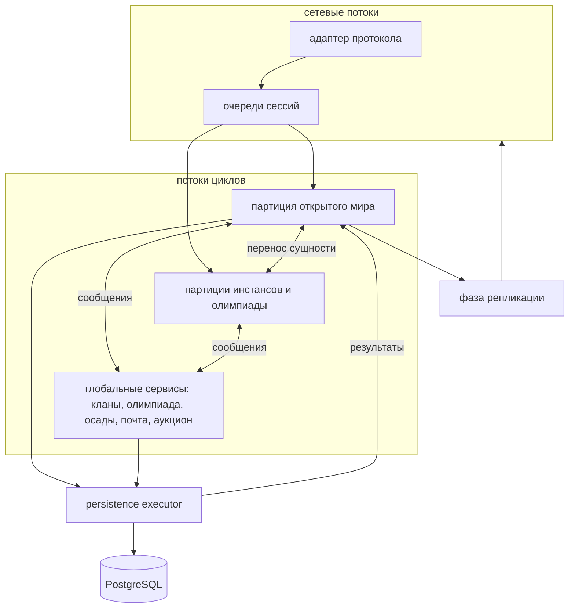

Эта страница описывает архитектуру, к которой движется игровой движок nx-l2: как работает симуляция, как устроены
игровые объекты, как состояние доходит до клиентов и базы данных и в каком порядке туда переходит импортированный код
L2J Mobius. **Это строящаяся цель, а не то, что сервер делает сегодня.** Сейчас сервер ещё работает на потоковой модели
Mobius; [путь миграции](#путь-миграции) ниже показывает, как она меняется шаг за шагом.

Решения приняты в [issue #18](https://github.com/l2nx/nx-l2/issues/18). Исследование, на котором они основаны (модели
тиков, ядра зрелых MMO-серверов, ECS, пространственное масштабирование, persistence), — на странице
[исследования движка](/ru/core/engine-research/).

## Принципы

- **Единственный неизменный контракт — клиент.** Протокол, смысл каждого пакета и измеренное поведение клиента заданы.
  Серверное поведение Mobius не является образцом для совпадения: каждый механизм выбирается по существу.
- **Один writer на каждый кусок состояния.** У любого изменяемого игрового состояния в каждый момент ровно один
  поток-владелец. В игровом состоянии нет блокировок и конкурентных коллекций.
- **Время и случайность — входные данные.** Игровой код читает часы и генератор случайных чисел своей партиции, а не
  системные часы или глобальный random. Поэтому для партиции возможны replay и тесты.
- **Отраслевая практика вместо изобретений.** Устройство ниже — то, к чему приходят авторитарные онлайн-игры. Свой код
  пишется только там, где этого требует Lineage 2.
- **Каждый шаг сохраняет играбельный сервер.** Импортированный код перерабатывается на месте, а не переписывается с
  нуля.

## Общий поток



## Партиции

Партиция — пространство симуляции за жёстким игровым швом. Сущности разных партиций никогда не взаимодействуют
напрямую, поэтому между партициями не нужны ни блокировки, ни hand-off протокол, кроме переноса сущности из одной в
другую.

- **Открытый мир — одна партиция.** Он не делится на регионы. Разделение бесшовного мира между несколькими writers —
  подход, который на практике провалился, а Lineage 2 сосредотачивает нагрузку именно на тех границах, которые создало
  бы разделение: на осадах. Если одного потока когда-нибудь не хватит, запасной вариант — параллельный открытый мир,
  принимаемый по замерам.
- **Каждый инстанс и каждый матч олимпиады — отдельная партиция.** В игре это и так отдельные пространства, поэтому
  шов ничего не стоит.
- **Глобальные сервисы** владеют состоянием, которое охватывает несколько партиций: кланы и альянсы, группы, участники
  которых в разных партициях, регистрация на олимпиаду, владение замками и расписание осад, почта, аукцион, мировые
  события. Каждый сервис — single writer со своим inbox. Партиции отправляют команды («игрок
  вступает в клан») и получают результаты; общее состояние, например названия кланов и владельцев замков, они читают из
  неизменяемых снимков, которые публикует сервис.
- **Все партиции работают в одном процессе** на пуле потоков циклов. Партицию в каждый момент выполняет один поток, а
  глобального барьера нет, поэтому тяжёлая партиция не задерживает остальные.

## Цикл партиции

Описанный здесь цикл — это [Zero-Tick Engine](/ru/core/zero-tick-engine/); на его странице — как он работает,
бенчмарки и сравнение с другими сборками.

Каждая партиция — event loop, а не тик с фиксированной частотой. Она спит до ближайшего из трёх событий: сообщения в
inbox, следующего дедлайна таймера, следующего запуска периодической системы.

- **Почему не фиксированный тик.** Тик в 100 или 50 мс добавляет до одного периода задержки к каждому действию игрока и
  округляет тайминги боя до тика. В цикле пакет обрабатывается в pass сразу после декодирования. Работа, пришедшая в
  пределах нескольких миллисекунд, всё равно собирается в один pass.
- **Тяжёлая работа по-прежнему идёт с интервалами.** Движение, видимость и AI работают для каждой сущности независимо от
  ввода, поэтому они запускаются как периодические системы со своими интервалами, выраженными во времени, а не в тиках.
  Никакая игровая логика не считает тики.
- **Пакеты одного клиента выполняются строго в порядке прихода.** У каждой сессии своя очередь; партиция обходит сессии
  round-robin с лимитом на pass, поэтому флудящий клиент задерживает только себя. В Mobius два пакета одного клиента
  могли выполняться одновременно или не по порядку, например подтверждение трейда против перемещения предмета. Этот
  класс гонок и дюпов исчезает.
- **Точные дедлайны.** Таймеры живут на одном timer wheel на партицию и несут абсолютные дедлайны. Повторяющееся
  действие планирует следующий запуск от предыдущего дедлайна, а не от «сейчас», поэтому атака раз в 333 мс в среднем
  остаётся 333 мс и не сползает. Отмена таймера бесплатна: устаревшая запись просто игнорируется при срабатывании.
- **Без catch-up всплесков.** За опоздавшим pass как можно скорее следует следующий; пропущенные периодические
  запуски не проигрываются пачкой — именно так циклы идут вразнос под нагрузкой.
- **Replay.** Партиция записывает свои входные данные, seed генератора случайных чисел и показания часов,
  поэтому инцидент можно прогнать через replay на той же сборке и превратить в тест.

Один pass идёт в фиксированном порядке: inbox, наступившие дедлайны, периодические системы, отложенные
побочные эффекты, репликация и один network flush на соединение.

Часы различают игровое время (откаты, касты, эффекты, движение) и wall-clock время (начало осады, периоды олимпиады,
ежедневные сбросы). Сейчас оба идут с одной скоростью; разделение оставляет будущее замедление перегруженной партиции
политикой часов, а не переделкой архитектуры.

## Модель сущностей

- **Объекты для скриптов, собранные из компонентов.** `Player`, `Npc`, `Item` и другие классы сущностей остаются
  фасадами, которые вызывают скрипты. За каждым фасадом состояние разделено на компоненты (движение, характеристики,
  статус, эффекты, инвентарь, AI), и каждый меняет только его система в потоке партиции. Огромный класс `Player`
  распадается на компоненты, а его поверхность для скриптов сохраняется.
- **Без переписывания на ECS.** Публичных примеров классического ядра MMO-сервера на чистой entity-component system нет,
  скрипты (около 310 тысяч строк) написаны против объектных фасадов, а измеренный выигрыш требует data-oriented
  хранения лишь на нескольких hot paths. Эти пути, например позиции для видимости или боевые характеристики на
  осадах, переходят на компактное хранение в массивах за своим компонентом только тогда, когда на них указывает
  профайлер.
- **Хэндлы, а не ссылки.** Сущности ссылаются друг на друга (цель, атакующий, владелец саммона, члены группы) по хэндлу,
  который разрешается через реестр партиции. Промах означает, что сущности больше нет. Висячие ссылки после деспауна и
  случайное разделение памяти между партициями становятся невозможны.
- **Синхронные события, отложенные побочные эффекты.** Существующая система событий для скриптов остаётся и работает в
  потоке партиции; асинхронных событий внутри процесса нет. Смерть, дроп, награды и опыт ставятся в очередь во время
  pass и выполняются в одном месте в фиксированном порядке.

## Эффекты

Баффы, дебаффы, тогглы и периодические эффекты работают на абсолютных дедлайнах timer wheel партиции. Бафф на 20
минут длится ровно 20 минут, а не «20 минут плюс до секунды», как при сканировании раз в секунду. Нет ни задачи на
каждый эффект, ни глобального сканирования. Двадцать наложенных баффов один раз помечают характеристики персонажа
как dirty, поэтому они пересчитываются и отправляются один раз за pass, а не двадцать, что важнее всего на осадах.

## Репликация

Отправка состояния клиентам — отдельная фаза после симуляции. Код симуляции никогда не пишет в сокеты; он записывает,
что произошло, в виде view events, а фаза репликации доставляет их сессиям, которые видят объект.

- **Игра не знает протокола.** Она принимает команды и выдаёт view events через порты. Протокол клиента — это
  адаптер, который превращает пакеты в команды, а view events — в пакеты, поэтому поддержка другой версии клиента
  добавляет мапперы, а не игровой код.

- **Точный client view.** Каждая сессия хранит набор объектов, показанных сейчас на её клиенте, поэтому у клиента не
  может остаться фантомный объект и не может пропасть настоящий. Видимость пересчитывается только для сущностей,
  пересёкших ячейку сетки; стоящие на месте объекты ничего не стоят.
- **Coalescing и бюджеты.** Несколько изменений HP за pass становятся одним обновлением. События делятся на критичные
  (отправляются всегда и по порядку), состояние (последнее значение за pass) и косметику (отбрасывается первой).
  Бюджет байтов на соединение с приоритетом для цели игрока, его группы и атакующих удерживает осаду с сотнями игроков в
  пределах сети.

Движок движения уже следует этой модели (время передаётся извне, хранится последнее намерение, состояние меняется
только в его шаге) и напрямую питает фазу репликации.

## Идентичность

| Вид           | Что                                    | Где используется                                 |
| ------------- | -------------------------------------- | ------------------------------------------------ |
| Persistent id | UUIDv7                                 | база данных, платформа, всё сохраняемое          |
| Wire handle   | 32-битное целое, выдаётся при загрузке | пакеты, реестр партиции, ссылки между сущностями |

- **Почему UUIDv7.** Он генерируется в процессе, поэтому предмет можно создать в потоке симуляции (дроп, крафт) без
  обращения к базе. Он уникален между серверами, поэтому слияние миров или перенос персонажей копирует строки без
  перенумерации. Он упорядочен по времени, поэтому вставки в базу остаются такими же дешёвыми, как с sequence. Цена —
  16 байт на ключ вместо 8 — пренебрежимо мала.
- **Почему wire handles.** Протокол во всех поддерживаемых хрониках передаёт id объектов как 32-битные целые, поэтому
  persistent id никогда не уходит в сеть. Хэндл выдаётся, когда персонаж входит в игру или NPC появляется в мире,
  сохраняется при переходе сущности между партициями и переиспользуется только после карантина в несколько минут,
  чтобы клиент, у которого остался старый id, не мог обратиться им к новому объекту.

## Persistence

- **Value transfers — транзакции базы данных.** Трейд, почта с вложениями, склады, магазины, аукцион и крафт
  выполняются каждый одной транзакцией PostgreSQL. Пока она идёт, задействованные предметы заблокированы в игре;
  результат возвращается в партицию, которая применяет или откатывает изменение. Дюп через «одна сторона сохранилась,
  другая нет, затем падение» структурно невозможен: точка сохранения одна.
- **Баланс плюс ledger.** Валюта и стекаемые предметы хранят баланс, который не может стать отрицательным, а каждое
  движение в той же транзакции пишет строку в append-only ledger. Ledger служит аудиту и позволяет точно
  убрать дюп вместо отката всего мира. Каждая операция несёт свой id, поэтому повторный запрос не выполнится дважды.
- **Всё остальное — write-behind.** Позиция, опыт, эффекты, умения и прогресс квестов отслеживаются как dirty и
  пишутся пачками примерно раз в 30 секунд. Падение теряет не больше этого прогресса и никогда — ценности. Выход из
  игры и остановка сервера сохраняют синхронно.
- **Никаких обращений к базе из игровых потоков.** Запросы выполняются на отдельном persistence executor; результаты
  возвращаются через inbox.

## Wiring и структура

- **Spring везде, с правилами для потоков.** Реестры данных, системы, глобальные сервисы, реестры обработчиков и
  persistence-сервисы — Spring-бины с constructor injection. Сущности, компоненты, события и сообщения — обычные
  объекты, которые создаёт движок. В коде партиций и сервисов не используются механизмы Spring, запускающие код в
  других потоках: scheduling становится дедлайнами партиции, application events — игровыми событиями, а транзакции
  базы данных идут только на persistence executor.
- **`engine/core` содержит runtime-механизмы**, не зависящие от хроники: циклы и таймеры, часы, партиции,
  идентичность, сессии, репликацию и persistence. Игровая механика, общая для хроник, переходит в `engine/` только когда
  вторая хроника докажет её идентичность.
- **Код хроники нарезан по фичам,** а не по техническим слоям: `combat`, `skill`, `effect`, `item`, `trade`,
  `clan`, `siege`, `olympiad` и так далее. Слайс владеет своими компонентами и системами, данными, командами и view events,
  репозиториями, таблицами и настройками. Пакеты-свалки вроде `managers` и `util` растворяются в слайсах.
  Структура репозитория — в [обзоре](/ru/core/overview/).

### Внутри слайса

Каждый слайс — модуль [Spring Modulith](https://spring.io/projects/spring-modulith) с одинаковой фиксированной
раскладкой. Корневой пакет — его API; остальное внутреннее, если не открыто как named interface.

```
<slice>
  (root)       API: фасад, outbound ports, value types из команд и view events
  command/     команды и их обработчики                          открыт адаптерам протоколов
  view/        view events и read-only views для мапперов        открыт адаптерам протоколов
  event/       domain events для систем и скриптов               открыт другим слайсам
  system/      системы                                           внутренний
  model/       компоненты и внутреннее состояние                 внутренний
  template/    статические данные: шаблоны, загрузчик, реестр    внутренний
  repository/  доступ к базе данных                              внутренний
```

- **Адаптер протокола читает только `view/`.** Компоненты изменяемы и принадлежат своей системе; адаптер видит
  view events и read-only views, поэтому сериализация пакета никогда не меняет игровое состояние.
- **Другой слайс используется только через свой корневой API.**

### Порты

Порты есть только там, где игра встречается с сетью или другим процессом:

| Edge           | В игру               | Из игры                  | Адаптер                          |
| -------------- | -------------------- | ------------------------ | -------------------------------- |
| игровой клиент | команда и обработчик | view event, `ClientPort` | клиентский протокол (`highfive`) |
| сервер логина  | команда и обработчик | `LoginPort`              | GS-link                          |
| база данных    | —                    | репозиторий              | сам репозиторий                  |

Всё, что входит в игру, — команда, кто бы её ни прислал, и у неё ровно один обработчик. Outbound port — интерфейс
с именем `<Edge>Port`. Репозиторий — обычный класс: база одна и реализация одна.

### Проверяется при каждой сборке

Тест запускает проверку Spring Modulith на перенесённых слайсах (нет циклов, нет доступа к внутренностям чужого слайса)
и правила ArchUnit для раскладки: фиксированные имена пакетов, где могут лежать команды, обработчики и события, порты
только как интерфейсы, ни один слайс не зависит от сетевого слоя. Правила, которые импортированный код ещё нарушает,
заморожены: сборка падает на любом новом нарушении, а список старых только сокращается.

## Путь миграции

Код Mobius переводится на эту архитектуру по шагам. Каждый шаг выходит сам по себе, заканчивается играбельным сервером
и принимается нагрузочным тестом с ботами, включающим осаду; пока ботов нет — по метрикам и игре настоящим клиентом.
Скрипты на каждом шаге вызывают фасады.

| #   | Шаг                                                                                                                      |
| --- | ------------------------------------------------------------------------------------------------------------------------ |
| 0   | Нагрузочный стенд: headless клиенты-боты со сценариями входа, движения, PvE, PvP и осады                                 |
| 1   | Метрики: сначала baseline текущего исполнения, затем время pass по партициям и фазам                                     |
| 2   | Идентичность: ключи UUIDv7 в схеме PostgreSQL, аллокатор wire handles, вместе с переходом на PostgreSQL                  |
| 3   | Value transactions, ledger, id операций, outbox                                                                          |
| 4   | Доступ к базе вне игровых потоков, write-behind                                                                          |
| 5   | Часы и генератор случайных чисел как входы; монотонное игровое время                                                     |
| 6   | Открытый мир как single writer: он разбирает очереди сессий, каждая задача мира идёт в его inbox                         |
| 7   | Подсистемы по одной переходят на дедлайны партиции: эффекты, бой, касты, AI, движение                                    |
| 8   | Фаза репликации; состояние мира доходит до клиентов view events                                                          |
| 9   | Глобальные сервисы; инстансы и матчи олимпиады как отдельные партиции                                                    |
| 10  | Переработка Java-пакетов по feature-слайсам, параллельно с шагами 6–9; сетевые пакеты становятся командами и view events |
| 11  | Data-oriented хранение на hot paths, которые покажет профайлер                                                           |

Главный риск несёт шаг 6: унаследованный код в одном потоке может не уложиться в бюджет. Метрики шага 1 измеряют это до
шага 6, а перерасход исправляется профилированием, а не возвратом к общим пулам потоков.
