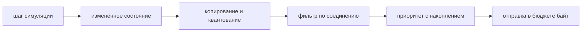

Прежде чем перестраивать движок, мы изучили, как выпущенные онлайн-игры ведут серверную симуляцию: как идёт время, как
мир делится между потоками и машинами, как состояние доходит до клиентов и базы данных и где всё ломалось. На этой
странице собрано то, что говорят публичные источники. У каждого утверждения есть ссылка на источник; заявления
разработчиков и вендоров помечены как таковые. Где публичного источника нет, страница молчит.

## Модели исполнения

### Фиксированный тик

Эталонная схема авторитетного сервера — фиксированный тик. Valve описывает цикл движка Source так: на каждом тике
сервер обрабатывает пришедшие команды игроков, выполняет шаг физики, проверяет правила игры, обновляет состояние
объектов и затем решает, каким клиентам нужен snapshot
([Valve: Source Multiplayer Networking](https://developer.valvesoftware.com/wiki/Source_Multiplayer_Networking)).
Snapshot сжимается как дельта относительно последнего обновления, подтверждённого клиентом.

Частота тика различается на два порядка:

| Игра                 | Тик            | Источник                                                                        |
| -------------------- | -------------- | ------------------------------------------------------------------------------- |
| Old School RuneScape | 600 мс         | [OSRS Wiki: Game tick](https://oldschool.runescape.wiki/w/Game_tick)            |
| Minecraft            | 50 мс (20 TPS) | [spark: The tick loop](https://spark.lucko.me/docs/guides/The-tick-loop)        |
| Игры на Source (TF2) | 15 мс (66 Гц)  | [Valve](https://developer.valvesoftware.com/wiki/Source_Multiplayer_Networking) |
| Valorant             | 128 Гц         | [Riot Tech Blog](https://technology.riotgames.com/node/112)                     |

Важна не скорость. В шутерах тик отвечает за точность симуляции. В MMO и песочницах тик становится **единицей
геймдизайна**, и тогда его уже нельзя свободно менять:

- **Valve** отключила опцию `-tickrate`, «because changing tickrate causes server timing issues»
  ([Valve](https://developer.valvesoftware.com/wiki/Source_Multiplayer_Networking)).
- **Игроки RuneScape** превратили работу с границами тика в отдельный навык
  ([OSRS Wiki: Tick manipulation](https://oldschool.runescape.wiki/w/Tick_manipulation)).
- **World of Warcraft** до 2014 года обрабатывал действия между юнитами пачками раз в 400 мс, затем «usually between
  1ms and 10ms later». WoW Classic намеренно вернул окно 400 мс, чтобы повторить оригинальный геймплей
  ([wowisclassic.com](https://www.wowisclassic.com/en/news/spell-batching-classic-wow-confirmed/)), а позже тестовый
  сервер Classic перешёл на окно 10 мс
  ([wowisclassic.com](https://www.wowisclassic.com/en/news/spell-batching-impact-ptr/)).

Если тик не укладывается в бюджет, следующий просто начинается позже. Minecraft откладывает следующий тик, потому что
«ticks cannot execute in parallel» ([spark](https://spark.lucko.me/docs/guides/The-tick-loop)), а загруженный мир
RuneScape идёт тиками по 0,616–0,618 с вместо 0,6 с ([OSRS Wiki](https://oldschool.runescape.wiki/w/Game_tick)).
Обратный рефлекс — догонять время лишними шагами — ведёт к «spiral of death»
([Gaffer On Games: Fix Your Timestep](https://gafferongames.com/post/fix_your_timestep/)).

### Sub-tick в CS2 и точные дедлайны

Сервер Counter-Strike 2 по-прежнему работает на 64 Гц, но клиент ставит каждому вводу метку точного момента внутри
тика, и сервер оценивает действие в этот момент. Маркетинг Valve на запуске утверждал: «tick rate no longer matters
for moving, shooting, or throwing»
([GameWorldObserver](https://gameworldobserver.com/2023/03/22/counter-strike-2-sub-tick-source-2-features-valve)). На
практике системе понадобилась серия патчей таймингов
([dust2.us](https://dust2.us/news/41336/cs2-11-9-update-new-wave-of-fixes-for-sub-tick-and-audio-issues)), а в опросе
14 из 37 профессиональных игроков назвали sub-tick главной проблемой игры
([dust2.us](https://dust2.us/news/63984/what-are-cs2s-biggest-issues-according-to-the-pros)). Описанные симптомы,
например нестабильные jump-throw ([Sportskeeda](https://sportskeeda.com/esports/even-64-tick-better-cs2-community-debates-sub-tick-system)),
происходят от гибрида: одни действия считаются по точному времени, а состояние, от которого они зависят, всё ещё
движется шагами по 64 Гц. Внутреннее устройство Valve не публиковала.

Меткам времени от клиента сервер доверять не должен. Переносится серверная часть идеи: **хранить точное время каждого
события внутри грубого прохода**. Атака, конец каста или тик эффекта хранят свой дедлайн в миллисекундах; проход
выполняет все наступившие события в порядке дедлайнов, а периодическое событие перепланируется от предыдущего дедлайна,
а не от момента, когда проход случайно запустился. Это тот же перенос остатка, что и в аккумуляторе из
[Fix Your Timestep](https://gafferongames.com/post/fix_your_timestep/), где оставшееся время «is not thrown away». Без
него тайминги квантуются по тику: в RuneScape каждое действие попадает на границу 600 мс, а запрос посреди тика ждёт
следующего ([OSRS Wiki](https://oldschool.runescape.wiki/w/Game_tick)).

### Таймеры на общих пулах и timer wheel

Стандартная структура для множества ожидающих таймеров — timer wheel (Varghese и Lauck, SOSP 1987): старт, остановка и
учёт на каждом тике за константное время
([the morning paper](https://blog.acolyer.org/2015/11/23/hashed-and-hierarchical-timing-wheels/)). На JVM на ней
построены `HashedWheelTimer` в Netty, Kafka и
[`DeadlineTimerWheel`](https://www.javadoc.io/static/org.agrona/agrona/1.5.0/org/agrona/DeadlineTimerWheel.html) в
Agrona. Колесо само по себе тоже тик с разрешением в ширину слота, и события внутри одного слота не упорядочены по
дедлайну, пока их не отсортировать.

Альтернатива — таймер на каждую сущность в общем пуле потоков — разносит игровую логику по множеству потоков. Это
работает только с блокировками вокруг каждого общего объекта, а порядок, в котором два таймера трогают одну цель, не
определён.

### Акторная модель

Лучше всего задокументированное применение акторов в играх — Microsoft Orleans за Halo 4. Orleans обслуживал облачные
сервисы: presence, статистику и пошаговую Galactic Reign. Статья приводит лабораторный тест: 1 млн акторов и около
130 000 heartbeat в секунду на 25 серверах. Авторитет боя оставался на консолях, «because the ground truth is always on
the consoles» ([Microsoft Research: Orleans](https://www.microsoft.com/research/publication/orleans-distributed-virtual-actors-for-programmability-and-scalability/)).

Активация в Orleans однопоточна и выполняется «ходами» (turns), так что каждый актор — единственный писатель. Для
боя модель подходит плохо: один удар одновременно читает и пишет несколько сущностей (ману атакующего, HP цели, агро,
соседей по области), и при акторе на сущность это превращается в протокол обмена сообщениями между ними. Публичных свидетельств боевой симуляции «актор на
сущность» в масштабе MMO мы не нашли.

Под игровым циклом и акторами лежит одна идея — принцип single writer из LMAX: «only one thing can ever write to a
single piece of data», что полностью убирает блокировки
([Oracle Java Magazine reprint](https://developer.aliyun.com/article/26394)).

## Как устроен сервер у зрелых MMO

**Эмуляторы World of Warcraft.** TrinityCore и AzerothCore открыты и показывают структуру целиком. Один мировой поток
выполняет `World::Update(diff)` — последовательность подсистем, каждая из которых замеряется через `METRIC_TIMER`,
включая обработку пакетов всех сессий. Затем он раздаёт карты пулу потоков `MapUpdater` и ждёт на барьере, пока не
закончатся все ([AzerothCore World.cpp](https://github.com/azerothcore/azerothcore-wotlk/blob/master/src/server/game/World/World.cpp),
[MapUpdater.cpp](https://github.com/azerothcore/azerothcore-wotlk/blob/master/src/server/game/Maps/MapUpdater.cpp),
[TrinityCore MapManager.cpp](https://github.com/TrinityCore/TrinityCore/blob/master/src/server/game/Maps/MapManager.cpp)).
Карту — континент или инстанс — обновляет один поток, поэтому логике карты блокировки не нужны. Результаты
асинхронных запросов к БД применяются в мировом потоке, а синхронный запрос в мировом или картовом потоке логируется
как предупреждение ([Main.cpp](https://github.com/azerothcore/azerothcore-wotlk/blob/master/src/server/apps/worldserver/Main.cpp)).
Слабое место — барьер: самая медленная карта задаёт тик всем остальным. `MapMgr` в AzerothCore разносит континенты,
поля боя и подземелья по трём шагам цикла, чтобы распределить эту нагрузку
([MapMgr.cpp](https://github.com/azerothcore/azerothcore-wotlk/blob/master/src/server/game/Maps/MapMgr.cpp)).
Официальный WoW справляется с толпой через layering: каждый слой — полная копия мира
([Wowhead](https://www.wowhead.com/news=294589/blizzard-clears-up-layering-tech-misconceptions-in-classic-wow)).

**EVE Online.** Один шард, разделённый по солнечным системам. Каждая нода выполняет tasklet'ы Stackless Python, где
«only one tasklet can be running at any given time», а физика Destiny обновляется раз в секунду. Когда нода
перегружена, CCP замедляет её игровые часы, вместо того чтобы дать ей упасть: Time Dilation подстраивается мелкими
шагами так, чтобы очередь tasklet'ов оставалась почти пустой
([CCP: Introducing Time Dilation](https://www.eveonline.com/news/view/introducing-time-dilation-tidi)). В примере из
блога с 1600 пилотами бой при 1200 вовлечённых кораблях шёл примерно на 60% скорости. В битве при Asakai TiDi упёрлась
в свой нижний предел 10% и всё равно деградировала мягче, чем прежние битвы
([Data Center Knowledge](https://datacenterknowledge.com/servers/experiencing-heavy-server-load-just-slow-down-time)).
Правило CCP о том, какие таймеры замедлять, стоит перенять дословно: «if you look at your watch to see what time an
event is going to complete, it probably shouldn't be dilated». Таймеры reinforcement идут по реальному времени,
перезарядка щитов — по игровому.

Остальные привычки CCP — операционные. Jita работает на отдельной ноде
([Tranquility Tech IV](https://www.eveonline.com/news/view/tranquility-tech-iv)), под объявленные крупные бои
резервируются ноды ([Fleet Fight Notification](https://www.eveonline.com/article/qd92g0)), а тяжёлая непространственная
работа уходит из симуляции: Brain in a Box заранее вычисляет эффекты навыков на отдельной ноде вместо пересчёта на
каждом прыжке ([forums archive](https://forums-archive.eveonline.com/topic/421522)), а Quasar выносит сериализацию и
маршрутизацию за пределы GIL Python ([Introducing Quasar](https://www.eveonline.com/news/view/introducing-quasar)).

**Guild Wars 2.** Карты работают как долгоживущие процессы-инстансы; megaserver создаёт копии карт по спросу и
распределяет игроков по группе, гильдии, языку и домашнему миру
([Engadget](https://www.engadget.com/2014-04-02-arenanet-rolls-out-the-megaserver-for-guild-wars-2.html)). Инстансы карт
живут неделями, поэтому падение сервера карты очень болезненно
([AWS for Games](https://aws.amazon.com/blogs/gametech/arenanet-guild-wars-mmorpg-migration)).

Картина везде одна: единицу мира симулирует один поток, параллелизм получают за счёт множества таких единиц, толпу
поглощают копии там, где это допускает дизайн, или замедление времени там, где не допускает, а база данных и
непространственные сервисы живут вне потока симуляции.

## Деление бесшовного мира

Каждая партиция выше отделена **жёстким игровым швом**: загрузочным экраном, гейтом, порталом или отдельной копией.
Карта TrinityCore — это континент или инстанс, а не регион внутри континента; её сетка ячеек служит видимости и
выгрузке, а не конкурентности ([GridDefines.h](https://github.com/azerothcore/azerothcore-wotlk/blob/master/src/server/game/Grids/GridDefines.h)).
Солнечная система EVE соседствует с другими только через гейты. Через такие границы ничто не взаимодействует, поэтому
не нужны ни ghost-копии, ни передача авторитета, ни распределённые транзакции.

С делением непрерывного пространства всё иначе:

- **SpatialOS.** Runtime Improbable делил мир между воркерами, каждый из которых видел частичное представление. Его
  балансировщику понадобилось отдельное исправление против «entities moving back and forth across different worker
  regions» ([Improbable](https://ims.improbable.io/insights/spatialos-runtime-update-2-new-load-balancing-system/)).
  Worlds Adrift, Mavericks и Lazarus были отменены один за другим
  ([PCGamesInsider](https://www.pcgamesinsider.biz/news/69519/ambitious-visionary-products-always-contain-some-risk-says-improbable-after-third-spatialos-project-bites-the-dust/)),
  хотя Bossa не винила платформу в закрытии Worlds Adrift
  ([PCGamesInsider](https://www.pcgamesinsider.biz/news/69671/bossa-doesnt-blame-improbable-for-worlds-adrifts-cancellation/)).
  В 2023 году Improbable продала свою студию мультиплеерных сервисов ([CNBC](https://www.cnbc.com/2023/12/18/metaverse-firm-improbable-sells-gaming-unit-for-97-million.html)).
- **New World.** Блог самой Amazon описывает статическую сетку: семь процессов-хабов на мир, каждый владеет двумя
  несмежными ячейками, за четырьмя шлюзовыми инстансами, которые служат единственными публичными адресами; состояние
  игрока переходит от хаба к хабу по мере движения
  ([AWS for Games](https://aws.amazon.com/blogs/gametech/the-unique-architecture-behind-amazon-games-seamless-mmo-new-world);
  блог вендора). Протокол передачи не опубликован.
- **Star Citizen.** CIG вынесла состояние мира из игровых серверов в replication layer
  ([Star Citizen Wiki](https://starcitizen.tools/Replication_layer)) и выпустила static server meshing в Alpha 4.0
  с 500 игроками на шард ([Star Citizen Wiki](https://starcitizen.tools/Server_meshing)). В начале 2026 года CTO
  сообщил о 600–800 на шард; dynamic meshing всё ещё был во внутренних тестах, а среди открытых проблем была потеря
  предметов при замедлении бэкенда ([StarShipDealers recap](https://www.starshipdealers.com/blog/sc-live-tech-talk-server-meshing-2026/),
  [Massively OP](https://massivelyop.com/2026/02/06/star-citizen-cto-outlines-progress-on-server-meshing-and-crafting-with-alpha-4-7-on-track-for-march/);
  заявления разработчика).
- **Ashes of Creation.** «Dynamic gridding» показали в 2024 году и тестировали в 2025-м
  ([Mein-MMO](https://mein-mmo.de/ashes-of-creation-fortschritte-juli-2025-alpha-staedte/); заявления разработчика в
  пересказе прессы). В начале 2026 года студия закрылась ([Wikipedia](https://en.wikipedia.org/wiki/Ashes_of_Creation)).

Ближайший прецедент на JVM — **Folia**, сервер Minecraft от PaperMC. Он объединяет соседние чанки в регионы, которые
тикают параллельно, сливаются и делятся на ходу, и «главного потока нет»
([Folia region logic](https://docs.papermc.io/folia/reference/region-logic)). Это работает, и README честно называет
цену: «I expect _every_ single plugin that exists to require _some_ level of modification»; глобальные scoreboard
сломаны, телепорт стал асинхронным, планировщик заменён четырьмя. Folia рассчитана на серверы, где игроки разбросаны по
карте, и рекомендует минимум 16 физических ядер ([Folia README](https://github.com/PaperMC/Folia)).

У Lineage 2 профиль нагрузки обратный: игроки собираются ровно там, где региональное деление провело бы границы, — на
осадах и у рейд-боссов. На 2026 год в публичных источниках нет живой MMO, которая динамически делит непрерывное
пространство и выдерживает нагрузку, а системы со статическим делением расплачивались проблемами передачи и
потерянными предметами.

## ECS на сервере

**Overwatch** — канонический выпущенный пример строгой entity-component-system в авторитетной игре
([GDC Vault](https://www.gdcvault.com/play/1024001/-Overwatch-Gameplay-Architecture-and)). По вторичному пересказу
доклада, выигрыш был структурным: сущности — это ID, компоненты — данные, системы не хранят состояние, сетевой код
геймплея сосредоточен в трёх системах, а побочные эффекты откладываются в одно место вызова за кадр. На то, чтобы
устоялись правила, по сообщениям, ушло около 1,5 лет, и главным источником багов был код, который их нарушал
([Edgegap](https://edgegap.com/blog/game-backend-deep-dive-overwatch-2016-netcode-architecture-rollback)).

В движках ECS — мейнстрим: **Unity DOTS** с Netcode for Entities
([Unity docs](https://docs.unity3d.com/Packages/com.unity.netcode@1.8/manual/ghost-snapshots)), **Unreal Mass**,
которая живёт рядом с миром Actor, а не заменяет его
([Epic docs](https://dev.epicgames.com/documentation/unreal-engine/overview-of-mass-entity-in-unreal-engine)), а также
**Flecs** и EnTT в выпущенных играх ([ECS FAQ](https://github.com/SanderMertens/ecs-faq)).

Ограничения описывают сами авторы ECS. В FAQ, который ведёт автор Flecs, сказано, что пространственные индексы обычно
живут вне ECS, иерархии через ссылки между компонентами замедляют итерацию, а правила ECS «conflict with OOP
intuition» ([ECS FAQ](https://github.com/SanderMertens/ecs-faq)). Множество отношений или переключаемых тегов дробит
сущности по таблицам ([Flecs Relationships](https://www.flecs.dev/flecs/Relationships.html)). Автор Artemis замечает,
что при паре сотен сущностей выбор фреймворка «probably doesn't matter»
([Artemis wiki](<https://github.com/junkdog/artemis-odb/wiki/Artemis-vs-Ashley:-(Don't)-Fight!>)). Мы не нашли
публичного postmortem MMO с RPG-навыками и эффектами на полной ECS и ни одного независимого бенчмарка ECS против
объектов при количестве сущностей, характерном для MMO.

Hytale — предостерегающий пример. В 2024 году команда объявила переписывание на C++ с Flecs в основе
([Hytale](https://hytale.com/news/2024/6/summer-2024-technical-explainer-hytale-s-entity-component-system-opwpcamdi)).
По данным вторичных источников, в 2026 году игра вышла в ранний доступ на прежнем сервере на Java
([Winternode](https://winternode.com/blog/hytale/hytale-server-hosting-guide)).

**Состояние на JVM.** Java-библиотеки ECS Artemis и Dominion числятся неактивными
([ECS FAQ](https://github.com/SanderMertens/ecs-faq)). Value classes (JEP 401) интегрированы в JDK 28 только как
preview ([JEP 401](https://openjdk.org/jeps/401)), поэтому в 2026 году компактная раскладка данных — это примитивные
массивы и примитивные коллекции. Generational ZGC — режим ZGC по умолчанию начиная с JDK 23, с целевыми паузами меньше
миллисекунды ([JEP 474](https://mail.openjdk.org/pipermail/jdk-dev/2024-May/008902.html)); аллокации на горячих путях
всё равно стоят времени.

## Репликация как отдельная фаза

Современные движки выполняют репликацию отдельным конвейером после шага симуляции. Iris в Unreal ведёт dirty-битовое
поле для каждого реплицируемого состояния; перед отправкой копирует и квантует изменённое состояние, затем фильтрует по
владельцу, соединению, группе или собственному пространственному правилу, затем приоритизирует. Приоритет копится между
тиками, пока объект не будет отправлен, поэтому низкоприоритетные объекты рано или поздно тоже уходят, а отправка
укладывается в бюджет на соединение
([Components of Iris](https://dev.epicgames.com/documentation/unreal-engine/components-of-iris-in-unreal-engine),
[Iris filtering](https://dev.epicgames.com/documentation/en-us/unreal-engine/iris-filtering-in-unreal-engine),
[Iris prioritization](https://dev.epicgames.com/documentation/unreal-engine/iris-prioritization-in-unreal-engine)).

Её предшественник, Replication Graph, создавался для Fortnite: узел двумерной сетки хранит для каждой ячейки список
видимых из неё акторов, и клиент копирует список своей ячейки вместо проверки расстояния до каждого актора
([Epic tech blog](https://www.unrealengine.com/tech-blog/replication-graph-overview-and-proper-replication-methods),
[Epic docs](https://dev.epicgames.com/documentation/en-us/unreal-engine/replication-graph-in-unreal-engine)).

Отдельную фазу позже можно вынести в отдельный сервис: replication layer в Star Citizen и шлюзовые инстансы New World —
это именно такой шаг. В массовом бою основная стоимость — сообщить всем о движениях, скиллах и эффектах всех
остальных, а это задача репликации, а не симуляции.

## Персистентность и целостность экономики

В зрелых системах база данных не участвует в тике. Авторитетное состояние живёт в памяти и пишется асинхронно или
периодически. TrinityCore сохраняет игрока раз в 90 с (`PlayerSaveInterval = 90000`) и при выходе, через
асинхронный worker БД
([worldserver.conf.dist](https://raw.githubusercontent.com/TrinityCore/TrinityCore/master/src/server/worldserver/worldserver.conf.dist)).
База EVE служит «primarily for storage»
([Tranquility Tech IV](https://www.eveonline.com/news/view/tranquility-tech-iv)). Veloren опрашивает загрузчик и
сохранятель персонажей раз за серверный тик ([Veloren docs](https://docs.veloren.net/veloren_server/persistence/character/index.html)).
Поскольку источник истины — память, ручные правки инвентаря онлайн-персонажа в БД не подхватываются или
перезаписываются ([TrinityCore forum](https://talk.trinitycore.org/t/inserting-bags-into-bag-slots/30918)).

У публично задокументированных дюпов одна причина: **передача между двумя игроками сохраняется в двух разных точках**.

- **RuneScape, 2020.** Игрок A передаёт предметы B, B выходит из игры и сохраняется, затем сервер намеренно роняют.
  Игроки откатываются к сохранению «from either 15 minutes ago, or their last logout», поэтому A получает предметы
  обратно, а B оставляет их у себя ([RuneScape Wiki](https://runescape.wiki/w/Server_crash_glitch)).
- **New World, 2021.** Персонажи со сбоем сохранения отправляли золото, выходили из игры, и сохранялась только сторона
  получателя ([PCGamesN](https://www.pcgamesn.com/new-world/gold-duping-bug)). Отдельный эксплойт возвращал стоимость
  апгрейда города, который так и не начался ([Mein-MMO](https://mein-mmo.de/new-world-gold-exploit-schon-wieder/)).
  На время исправления Amazon отключила все передачи ценностей ([WePC](https://www.wepc.com/gaming/new-world/players-discover-new-world-gold-exploit-causing-gold-dupes/)).
- **Diablo IV, 2025.** Начатый трейд и выход из клиента оставляли предметы у обоих игроков; Blizzard приостановила
  торговлю ([Shacknews](https://shacknews.com/article/136657/diablo-4-player-trading-suspended-duplicate-exploit)).
- **Order & Chaos.** Многократное нажатие «extract all» в почте давало несколько копий — случай отсутствующей
  идемпотентности
  ([DroidGamers](https://www.droidgamers.com/news/gamelofts-mmorpg-order-and-chaos-hit-with-more-problems-this-time-of-the-item-duping-kind/)).

Идентичность предметов — отдельная точка отказа. В 2010 году в EVE упал скрипт, переиспользовавший ID удалённых
предметов; новые предметы не получали ID, инвентари сломались, затронуто до 114 000 ID предметов
([CCP](https://www.eveonline.com/news/view/extended-downtime-friday-07-may-due-to-database-problems-some-ingame-items-affected)).
Когда дюп всё же выходит наружу, последнее средство — откат мира, который стоит каждому игроку недавнего прогресса
([OSRS Wiki: Rollback](https://oldschool.runescape.wiki/w/Rollback)).

Лекарства следуют из инцидентов. Передача ценности — **одна транзакция БД**, охватывающая обе стороны, и игрок получает
подтверждение только после коммита; работа McGill о персистентности MMO говорит то же: «critical events must be
written synchronously» ([Kemme et al., NetGames 2008](https://cs.mcgill.ca/~kemme/papers/netgames08-persistence.html)).
У предметов неизменяемая идентичность, которая никогда не переиспользуется. Каждая операция, которую можно повторить
(получение почты, покупка), несёт operation id и применяется один раз. Append-only журнал движений ценностей позволяет
точечно убрать продублированное вместо отката мира. Обычное состояние вроде HP, позиции или опыта может идти через
write-behind, где в пределах окна записывается только последнее значение по ключу
([Hazelcast MapStore](https://docs.hazelcast.com/hazelcast/5.5/mapstore/configuration-guide)); coalescing безопасен
для состояния, но никогда не для передач.

## Деградации и replay нужно одно и то же

Time Dilation работает только потому, что игровая логика EVE читает игровые часы, а не системные. Детерминированному
replay нужно то же самое: Factorio находит расхождение, сравнивая CRC всей карты на каждом тике при воспроизведении
сохранения, и разница обычно сводится к «a value of one variable»
([Factorio FFF #47](https://factorio.com/blog/post/fff-47)). Детерминизм хрупок: desync 2024 года удалось воспроизвести
только симуляцией другого числа ядер процессора ([FFF #415](https://direct.factorio.com/blog/post/fff-415)), а
параллельные системы без фиксированного порядка — это ровно те «execution order ambiguities», о которых сообщает Bevy
([bevy_ecs](https://docs.rs/bevy_ecs)). Авторитетному серверу не нужен lockstep между клиентами, но если партиция
выполняется в одном потоке и читает время и случайность только через внедрённые источники, для её повторного прогона
достаточно журнала её входов.

Перегрузку нужно сначала измерить, а потом обрабатывать. Spark, профайлер для Minecraft, считает простой меньше 5%
времени тика признаком лага и предупреждает, что средние значения скрывают пики по 300 мс
([spark](https://spark.lucko.me/docs/guides/The-tick-loop)); AzerothCore замеряет каждую подсистему своего мирового
обновления ([World.cpp](https://github.com/azerothcore/azerothcore-wotlk/blob/master/src/server/game/World/World.cpp)).

## Что nx-l2 берёт из этого

Результат описан на странице [архитектуры](/ru/l2/architecture/). Коротко:

- **Один писатель на партицию, партиции за жёсткими швами.** Открытый мир — одна партиция; каждый инстанс и матч
  олимпиады — отдельная. Непрерывный мир не делится на регионы: именно там собирается толпа в Lineage 2 и именно там
  ломались разделённые миры.
- **Нет глобального барьера.** Партиции работают независимо, и тяжёлая не задерживает остальные.
- **Точные дедлайны вместо грубого глобального тика.** Атаки, касты и эффекты хранят точное время наступления, а
  периодическая работа переносит остаток; таймеры уходят из общего пула потоков импортированного кода в партицию,
  которая владеет состоянием.
- **Внедрённые время и случайность**, с разделением по механикам на игровое и реальное время, чтобы замедление времени
  и replay оставались возможны.
- **Объекты остаются фасадом, который вызывают скрипты**, и собираются из частей; data-oriented хранилища — только там,
  где профилирование показывает горячий путь. Переписывания на ECS нет.
- **Репликация — отдельная фаза** после симуляции, с бюджетами на соединение.
- **База данных вне игровых потоков**, write-behind для обычного состояния, одна транзакция плюс журнал на каждую
  передачу ценности и постоянные идентификаторы предметов, которые никогда не переиспользуются.
- **Сначала измерения.** Время прохода по партициям и подсистемам и нагрузочные тесты ботами, включая сценарий осады.
- **Наш движок движения** работает внутри той же модели партиций, что и остальная симуляция.
