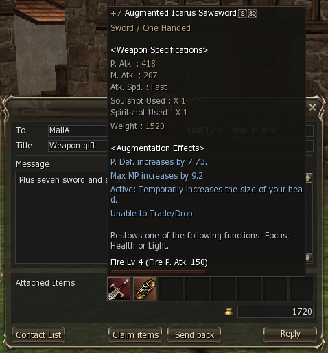
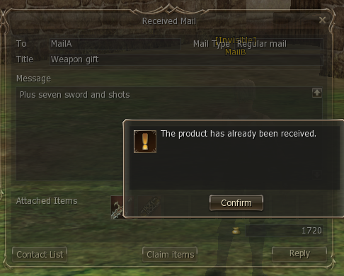
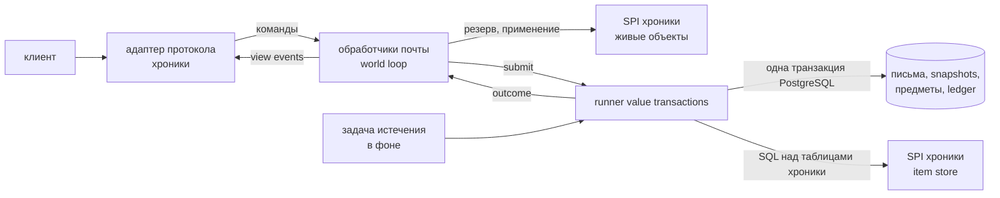
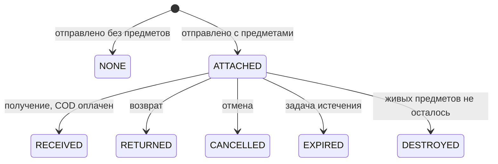

Почта движка L2NX — модуль, общий для всех хроник с почтой, на value transactions: каждый перенос предметов или адены — одна ACID-транзакция с idempotency key,
каждое письмо хранит неизменяемый snapshot своих вложений.

**Состояние:** модуль движка `engine/mail`, работает в хронике High Five (Essence подключится со своими значениями по умолчанию), и первый потребитель value transactions; следом идут трейд, склады и
магазины.

## Игровые функции

Официальная почта: письма с вложениями до `max-attachments` и наложенным платежом по желанию, входящие
и отправленные, получение, возврат, отмена, удаление, истечение, системная почта и почта на день рождения.

## История вложений

При отправке каждое вложение фиксируется в неизменяемый item snapshot: шаблон, количество, заточка, custom types, мана
и срок предмета, аугментация, атрибуты атаки и защиты, enchant options. Snapshot пишется один раз в транзакции
отправки и никогда не обновляется; живой предмет переносится независимо при получении, возврате, отмене или истечении.

- Полученные и отправленные письма всегда показывают вложения по snapshots, закрыто письмо или нет.
- Клиент оставляет «Получить» («Отменить» в копии отправителя) на закрытом письме; «Получить» отвечает системным
  сообщением 3382 (в английском клиенте «The product has already been received.»), «Отменить» — сообщением 3030
  («You cannot cancel sent mail since the recipient received it.»).
- Возвращённое письмо получает копии строк snapshot оригинала.
- Удаление и истечение только прячут письмо; письмо, его snapshots и строки ledger сохраняются.






## Преимущества

### Атомарные переносы exactly-once

Отправка, получение, возврат, отмена и истечение — каждая одна ACID-транзакция над письмом, предметами, аденой и
ledger: падение до коммита ничего не меняет. Каждая транзакция несёт idempotency key, поэтому повтор выполняется
exactly-once: повторный ключ воспроизводит записанный результат, а не выполняется заново.


### Conditional update вместо блокировок

Каждый переход из `ATTACHED` — conditional update (`WHERE attachments = 'ATTACHED'`), optimistic concurrency на строке
письма: из получения, отмены и истечения, конкурирующих за одно письмо, коммитится ровно одно.


### Append-only история

Удаление и истечение только прячут письмо; письма, snapshots и value ledger никогда не удаляются. Найденный позже дюп
трассируется и убирается по ledger, без отката мира.

### Конфигурация

Сборы, сроки жизни, размер ящика, число вложений, интервал отправки и правила зон, боя и смерти — настройки
`l2nx.mail.*` со значениями официальных серверов по умолчанию.

### Офлайн-участники

Получатель, получатель наложенного платежа и владелец при истечении не обязаны быть в сети: их строки меняются на
дельту в той же транзакции.

### Общий модуль

`engine/mail` обслуживает каждую хронику с почтой через SPI; новая хроника добавляет свои protocol mappers и свои поля
snapshot.

## Сравнение с другими сборками

| Возможность                                      | L2NX | L2J Mobius | aCis | L2J Server | Линия L2-Scripts | Не-Java переписывания |
| ------------------------------------------------ | :--: | :--------: | :--: | :--------: | :--------------: | :-------------------: |
| Snapshots вложений после получения               |  ✓   |     ✗      |  —   |     ✗      |        ✗         |           ✗           |
| Атомарные отправка и получение (одна транзакция) |  ✓   |     ✗      |  —   |     ✗      |        ✗         |           ✗           |
| Идемпотентные повторы                            |  ✓   |     ✗      |  —   |     ✗      |        ✗         |           ✗           |
| История после удаления и истечения               |  ✓   |     ✗      |  —   |     ✗      |        ✗         |           ✗           |

По открытому исходному коду каждого семейства, линии High Five; ✓ — есть, ✗ — нет, — — почты нет (aCis — Interlude, в
Interlude почты нет). Не-Java переписывания: lineage2ts (TypeScript, High Five); переписывания на Elixir, C# и Python —
Interlude. Факты по клеткам — в [подробном сравнении](#подробное-сравнение).

## Как это работает

### Модуль

`engine/mail` владеет своими таблицами, командами, view events, настройками и задачей истечения и не зависит ни от
одной хроники. SPI хроники имеет две стороны:

- **World loop, живые объекты:** какие предметы можно отправить, резервирование предметов и сбора, место для входящих
  предметов, применение закоммиченного переноса к памяти, состояние участника (мирная зона, бой, трейд, тюрьма).
- **Транзакция, таблицы хроники:** поиск получателя, block list, перенос строк предметов, адена обеих сторон. Модуль
  никогда не пишет в таблицы хроники.



Источник истины — база данных; письма не кэшируются. Списки и открытые письма — read-only запросы вне world loop.
Почта — не глобальный сервис: одновременные изменения сериализует строка письма, а single writer в памяти добавил бы
только кэш, который нужно согласовывать с офлайн-записями.

### Value transactions

Каждый перенос (отправка, получение, возврат, отмена, истечение, удаление персонажа) — одна транзакция PostgreSQL,
которая обновляет письмо, предметы и адену и добавляет по строке value ledger на каждое движение.

1. Обработчик проверяет правила на world loop и ставит **pending marks** на зарезервированные предметы и адену;
   мутации контейнеров отклоняют помеченные предметы на любом пути, включая скрипты.
2. Runner выполняет транзакцию на persistence executor.
3. Outcome возвращается в цикл, который применяет коммит к памяти и снимает метки.

```mermaid
sequenceDiagram
  participant P as игрок
  participant L as world loop
  participant R as runner транзакций
  participant D as PostgreSQL
  P->>L: Получить
  L->>D: чтение письма и snapshot (вне цикла)
  L->>L: проверка, резерв, pending marks
  L->>R: submit(idempotency key)
  R->>D: claim ключа; UPDATE ... WHERE ATTACHED;<br/>перенос предметов; COD; ledger; COMMIT
  R-->>L: Committed
  L->>L: применение к памяти, снятие меток
  L-->>P: предметы, системные сообщения
```

**Idempotency key.** UUIDv7, который мир создаёт на действие игрока; скрипты и платформа передают свой (подарок на
день рождения выводит его из персонажа и года). Runner сначала делает claim ключа под unique constraint, поэтому
конкурентный дубликат блокируется на первом и затем воспроизводит его.

**Outcomes.**

| Outcome     | Значение                                                   | Действие цикла                     |
| ----------- | ---------------------------------------------------------- | ---------------------------------- |
| `Committed` | закоммичено                                                | применить, снять метки             |
| `Replayed`  | ключ уже закоммичен; возвращаются его строки ledger        | применить закоммиченные строки     |
| `Refused`   | условие не выполнилось внутри транзакции; откат            | снять метки, сообщить причину      |
| `Failed`    | ошибка до коммита; откат                                   | снять метки, сообщить о сбое       |
| `Unknown`   | соединение потеряно в момент коммита; результат неизвестен | оставить метки, разрешить по ключу |

**Разрешение `Unknown`.** Lookup сам делает claim ключа с коротким lock timeout: блокируется на транзакции, которая
ещё коммитится, получает конфликт, если она закоммичена (`Replayed`), иначе проходит и откатывается, что делает
fencing оригинала (`Failed`). Timeout — снова `Unknown`; lookup повторяется с backoff 1, 5, 30, затем 60 с. Метки
держатся до разрешения, поэтому сохранение не перезапишет перенесённые строки.

Уровень изоляции — `READ COMMITTED`: conditional update, конкурирующий с закоммиченным, перечитывает строку, а не
падает с ошибкой сериализации. Коммиты синхронные. Meter: `l2nx.value.transaction` (timer, теги `type`, `outcome`).

### Online- и offline-стороны

- **Online:** предметами владеет партиция, база отстаёт до следующего сохранения; транзакция пишет абсолютное
  состояние из памяти под условием владельца, ledger записывает дельту.
- **Offline:** строки меняются на дельту под `CHECK (count >= 0)` с объединением в существующий стек или вставкой.

Пока транзакция идёт, зарезервированные предметы персонажа исключены из сохранений, а вход в мир и выход ждут outcome,
поэтому ни сохранение до коммита, ни логин не конкурируют с коммитом.

### Item snapshot

Пишется один раз на слот в `mail_attachments` при отправке и никогда не обновляется:

| Поле                           | Содержимое                                             |
| ------------------------------ | ------------------------------------------------------ |
| `item_template_id`, `count`    | шаблон, количество                                     |
| `enchant_level`                | заточка                                                |
| `custom_type1`, `custom_type2` | custom types                                           |
| `mana_left`, `item_expires_at` | мана shadow item, срок предмета с ограничением времени |
| `augmentation_option1`, `…2`   | аугментация                                            |
| `attack_element`, `…_power`    | атрибут атаки и его сила                               |
| `fire` … `dark`                | атрибуты защиты                                        |
| `enchant_option1` … `3`        | enchant options                                        |

Живые предметы остаются строками предметов с локацией `MAIL` и id письма и в память не загружаются. Поля конкретной
хроники идут в таблицу хроники с ключом `(mail_id, slot)`; у High Five таких нет. Mail attachment — это snapshot плюс
живой предмет, пока он в письме.

### Состояния



- Каждый переход из `ATTACHED` — `UPDATE … WHERE attachments = 'ATTACHED'`; из конкурирующих переходов совпадает
  ровно один.
- **Возврат** создаёт новое письмо отправителю (`returned_from_id`, тот же тип, без COD, свой срок); живые предметы
  переезжают в него, его строки snapshot — копии; оригинал остаётся `RETURNED`.
- **Destroyed:** получение без живых предметов закрывает письмо без списания COD; удаление персонажа уничтожает
  вложения, которые некому получить, и записывает их в ledger.
- Сторона может удалить письмо, только когда оно уже не `ATTACHED`.

### Типы писем

| Тип        | Отправитель, которого показывает клиент | Возврат, ответ |
| ---------- | --------------------------------------- | -------------- |
| `PLAYER`   | игрок                                   | да             |
| `SYSTEM`   | системный отправитель клиента           | нет            |
| `BIRTHDAY` | отправитель дня рождения клиента        | нет            |

Значения на проводе — код протокола в адаптере хроники.

### История

Письма и строки snapshot никогда не удаляются. Письмо хранит имена отправителя и получателя на момент отправки,
timestamps отправки, прочтения и закрытия, итоговое состояние и timestamps удаления каждой стороной и истечения.
Value ledger хранит каждое движение с его транзакцией: держатель (инвентарь, склад или письмо), предмет, шаблон,
дельта.

### Настройки

`l2nx.mail.*` в `config/application.yaml` ([эксплуатация](/ru/core/operations/)); значения по умолчанию —
официальные; хроника переопределяет то, что у неё отличается.

| Ключ                          | По умолчанию | Значение                                                                          |
| ----------------------------- | ------------ | --------------------------------------------------------------------------------- |
| `enabled`                     | `true`       | почта включена                                                                    |
| `attachments.enabled`         | `true`       | предметы и наложенный платёж                                                      |
| `attachments.peace-zone-only` | `true`       | действия с вложениями (отправка, получение, возврат, отмена) только в мирной зоне |
| `attachments.deny-in-combat`  | `false`      | действия с вложениями запрещены в бою                                             |
| `attachments.deny-when-dead`  | `false`      | действия с вложениями запрещены после смерти                                      |
| `fee.base`                    | `100`        | адена за письмо                                                                   |
| `fee.per-attachment`          | `1000`       | адена за вложение                                                                 |
| `max-attachments`             | `8`          | вложений в письме, 1–8 (клиент показывает 8 слотов)                                |
| `mailbox-limit`               | `240`        | видимых писем в ящике                                                             |
| `expiry`                      | `360h`       | срок жизни письма                                                                 |
| `cod-expiry`                  | `12h`        | срок жизни письма с наложенным платежом                                           |
| `send-interval`               | `10s`        | минимальный интервал между отправками персонажа; `0s` отключает                   |
| `expiry-poll`                 | `1m`         | период задачи истечения                                                           |

Интервал отправки — bucket Bucket4j на персонажа.

### Протокол 267 (клиент High Five)

- **Вложения рендерятся из snapshots** с синтетическими object id `slot + 1`. Id живых объектов начинаются с
  `0x10000000`, диапазоны не пересекаются; клиент никогда не присылает id вложений, каждый запрос называет только
  письмо.
- **Id писем на проводе** — номера, локальные для сессии, отображённые на UUID (не больше 480 записей на оба ящика);
  почта ничего не берёт у аллокатора id мира.
- **Флаги:** `WithItem` только пока `ATTACHED`, `Trade` только пока COD не оплачен, `ReturnAble` только для
  незакрытого, не возвращённого письма `PLAYER`.
- **Темы** в списках обрезаются до 96 символов, чтобы полный ящик из 240 писем влез в один frame (65535 байт);
  открытое письмо несёт тему целиком.

## Подробное сравнение

| Семейство        | Хранение вложений                                                        | После получения                                              | Persistence                                                                                                            | Повторы         | Удаление и истечение                 |
| ---------------- | ------------------------------------------------------------------------ | ------------------------------------------------------------ | ---------------------------------------------------------------------------------------------------------------------- | --------------- | ------------------------------------ |
| L2NX             | живые строки предметов (`MAIL`) плюс строка snapshot на слот             | snapshot хранится и показывается                             | одна ACID-транзакция: письмо, предметы, адена, ledger                                                                  | idempotency key | строки остаются, скрыты с timestamps |
| L2J Mobius       | живые строки предметов (`MAIL`, id сообщения)                            | `transferItem`, затем `removeAttachments`: предметы не видны | отдельные записи, без SQL-транзакции; COD офлайн-отправителю — новый предмет адены, сохраняемый отдельно               | нет             | `DELETE FROM messages`               |
| L2J Server       | та же модель (`Message`, `MailManager`)                                  | то же                                                        | отдельные записи, без SQL-транзакции                                                                                   | нет             | `DELETE FROM messages`               |
| Линия L2-Scripts | таблица ссылок `mail_attachments (message_id, item_id)` на живой предмет | ссылки очищаются; письмо без текста удаляется                | изменения в памяти под `synchronized`, сохраняются по отдельности; офлайн-отправителю платят через отложенные предметы | нет             | `DELETE FROM mail`                   |
| lineage2ts       | item container на письмо                                                 | `removeAttachments`                                          | изменения в памяти; письма сохраняются с debounce 15 с, предметы — своим кэшем                                         | нет             | `DELETE FROM mail_messages`          |
| aCis             | почты нет (Interlude)                                                    | —                                                            | —                                                                                                                      | —               | —                                    |

Ни одно из этих открытых деревьев не хранит snapshots вложений, не выполняет отправку или получение одной транзакцией
и не делает действия с почтой идемпотентными.

## Ограничения

- **«Получить» видна на закрытом письме.** В протоколе 267 нет флага «уже получено»; клиент показывает «Получить»
  («Отменить» в копии отправителя), когда в письме перечислены предметы, а сервер отвечает 3382 / 3030. Патч клиента,
  прячущий обе кнопки, отложен.
- **Темы в списках обрезаются до 96 символов** (лимит размера frame); открытое письмо полное.
- **События платформы придут с адаптером:** каждая закоммиченная транзакция почты будет публиковать событие с
  перенесёнными snapshots через transactional outbox, который появится вместе с адаптером платформы L2NX
  ([#13](https://github.com/l2nx/nx-l2/issues/13)).
- **Почта — первый потребитель:** трейд, склады и личные магазины пока сохраняются по-старому.

## Читать дальше

- [Архитектура](/ru/core/architecture/#persistence): партиции, persistence и value transactions.
- [Zero-Tick Engine](/ru/core/zero-tick-engine/): world loop, на котором работают обработчики почты.
- [Глоссарий](/ru/core/glossary/#mail): mail, mail attachment, item snapshot, value transaction и связанные термины.
