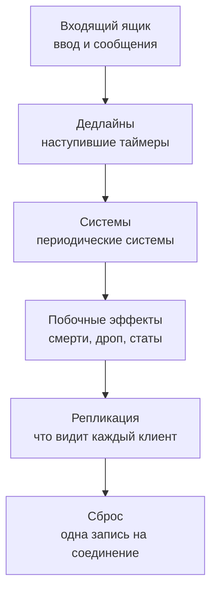

## Мир, который не тикает. Он реагирует.

Каждое действие игрока, каждый удар и каждый бафф обрабатываются в момент, когда они происходят: без тиков, без гонок,
без холостой работы.


**Состояние:** ядро движка уже в nx-l2, и мир переезжает на него шаг за шагом. См.
[путь миграции](/ru/core/architecture/#путь-миграции).

## Почему Zero-Tick

### Быстрее

Таймеры, баффы и откаты обходятся в разы дешевле, чем в классических сборках.

### Никаких дюпов

Предмет не может оказаться в двух местах: изменения инвентаря идут строго по одному, в собственном потоке пространства.


### Никаких гонок

Удар и Sleep, прилетевшие в один момент, всегда разрешаются одинаково — в порядке прихода. Атака будит спящую цель,
поэтому порядок решает исход боя.


### Мгновенная реакция

Ничто не ждёт «следующего тика»: действие обрабатывается сразу.

### Без холостой работы

Каждое пробуждение — настоящее событие: ни пустых тактов, как в тиковых сборках, ни задач, крутящихся на пустых
пулах, как в сборках на пулах потоков.

### Видно всё

Где тормозит, в какой фазе, в каком проходе: метрики Prometheus из коробки, готовые для вашей Grafana.

### Любой баг воспроизводим

Прошедший бой можно проиграть заново шаг за шагом: время и случайность берутся только из прохода, а seed пишется в лог.

## Zero-Tick против классических сборок

| Возможность                                        | Zero-Tick | L2J Mobius | aCis | L2J Server | Линия L2-Scripts | L2E (Elixir) |
| -------------------------------------------------- | :-------: | :--------: | :--: | :--------: | :--------------: | :----------: |
| Просыпается только на события, без опроса          |     ✓     |     ✗      |  ✗   |     ✗      |        ✗         |      ✗       |
| Без блокировок на игровом состоянии, один писатель |     ✓     |     ✗      |  ✗   |     ✗      |        ✗         |      ✓       |
| Дюпы исключены самим устройством                   |     ✓     |     ✗      |  ✗   |     ✗      |        ✗         |      —       |
| Детерминированный повтор                           |     ✓     |     ✗      |  ✗   |     ✗      |        ✗         |      ✗       |
| Встроенные метрики Prometheus                      |     ✓     |     ✗      |  ✗   |     ✗      |        ✗         |      ✗       |
| Бюджет прохода с разбивкой по фазам                |     ✓     |     ✗      |  ✗   |     ✗      |        ✗         |      ✗       |

По открытому исходному коду каждого семейства; ✓ — есть, ✗ — нет, — — не установлено. Факты за каждой клеткой — в
[подробном сравнении](#подробное-сравнение) ниже, в разделе «Под капотом».

## Тик против Zero-Tick


Классический сервер просыпается по фиксированному тику, например раз в 100 мс, и обрабатывает всё, что накопилось с
прошлого раза. Выглядит как «всё одновременно», но это не так. Действие, пришедшее сразу после тика, ждёт следующего до
100 мс. Внутри тика события всё равно выполняются одно за другим, в том порядке, в каком лежат в списке. Тик чаще, хоть
100 раз в секунду, лишь сокращает ожидание; два события от этого одновременными не становятся. Zero-Tick убирает
ожидание и закрепляет порядок: каждое событие обрабатывается, когда пришло, и порядок одинаков при каждом запуске.

**Тик заставляет мир ждать. Zero-Tick — нет.**

---

## Под капотом

### Как устроен проход

Пространство мира (партиция) — это цикл событий в собственном потоке. Его никто не опрашивает:

1. Поток ввода-вывода Netty (epoll в Linux) декодирует пакет клиента и кладёт его в очередь сессии.
2. Поднимается флаг готовности сессии, а во входящий ящик партиции приходит «у этой сессии есть ввод»; если поток
   цикла запаркован, его будит `LockSupport.unpark`.
3. Когда ввода нет, цикл паркуется в `LockSupport.parkNanos` до ближайшего дедлайна: следующего таймера или следующего
   запуска периодической системы. Если ничего не запланировано, он так и остаётся запаркованным.

Проснувшись, цикл один раз читает часы и выполняет один проход из шести фаз в фиксированном порядке:



- **Одно чтение часов на проход.** Каждая механика в проходе видит одно и то же «сейчас», и именно поэтому проход
  можно воспроизвести.
- **Детерминированный порядок.** Наступившие таймеры выполняются в порядке `(deadline, sequence)`; при равных дедлайнах
  sequence сохраняет порядок регистрации. При равном дедлайне периодический тик (`TICK`) идёт раньше конца его эффекта
  (`END`), поэтому последний тик урона от яда никогда не теряется из-за того, что яд кончился.
- **Всплески делят один проход.** Между проходами есть минимальный интервал (`pass-min`, см.
  [эксплуатацию](/ru/core/operations/)), поэтому пачка ввода, пришедшая внутри него, обрабатывается одним проходом, а не
  многими.
- **Последствия в том же проходе.** Работа, порождённая внутри прохода (сработавший триггер-скилл, смерть от тика
  урона), выполняется в том же проходе с ограничением глубины, поэтому цепочка триггеров не может зациклиться.

### Zero-Tick, тики и ECS

Тик или Zero-Tick — это модель планирования: она решает, когда выполняется работа. ECS (entity-component-system) —
модель данных и кода: она решает, как разложены состояние и логика. Одно от другого не зависит. На практике
ECS-движки — Bevy, Unity DOTS, Flecs — почти всегда работают на тике: каждый кадр расписание обходит все сущности, у
которых есть компоненты, нужные системе.

|                       | Классический L2J (тики + пулы)              | ECS (в духе Bevy)                                                             | Zero-Tick                                                                                                    |
| --------------------- | ------------------------------------------- | ----------------------------------------------------------------------------- | ------------------------------------------------------------------------------------------------------------ |
| Когда идёт работа     | задачи с фиксированной частотой и тики      | каждый кадр                                                                   | на ввод, наступивший дедлайн или запуск периодической системы                                                |
| Работа на пробуждение | все наступившие задачи, даже пустые         | все сущности с компонентом, O(сущностей) на тик                               | только то, что затронуто, O(событий)                                                                         |
| Потоки                | общий пул плюс `synchronized`: гонки и дюпы | планировщик распараллеливает системы по доступу к компонентам, без блокировок | один поток-писатель на партицию, партиции параллельно                                                        |
| Порядок и детерминизм | на усмотрение планировщика ОС               | детерминирован при фиксированном шаге                                         | одно «сейчас» на проход, порядок `(deadline, sequence)`, повтор                                              |
| Сильная сторона       | просто и привычно                           | плотная работа каждый кадр, обход, дружественный кешу                         | разреженная работа: большинство объектов простаивает, редкие точные события — баффы, откаты, респауны, удары |
| Слабая сторона        | гонки, холостые задачи, ничего не видно     | пустые тики, задержка до шага, переписывание всех скриптов                    | плотную покадровую работу приходится выносить в периодические системы                                        |

**Почему Lineage 2 подходит Zero-Tick.** Мир MMO разрежен: тысячи NPC стоят без дела, а у каждого игрока десятки
баффов и откатов, и каждый кончается в свою миллисекунду. Тик ECS проверяет их все каждый кадр; Zero-Tick просыпается
ровно тогда, когда наступает один из них.

**Гибрид, а не противник ECS.**

- **Разреженное — на событиях:** эффекты, откаты, респауны и ввод работают через колесо таймеров и входящий ящик.
- **Плотное — периодические системы в стиле ECS:** движение и видимость обходят свои компоненты со своим интервалом,
  внутри того же прохода и в том же потоке-писателе.
- **Данные — в стиле ECS:** состояние лежит в компонентах, которыми владеют системы, а data-oriented хранение
  появляется там, куда укажет профилировщик.
- **Почему не чистый ECS:** нет открытого примера классического ядра MMO-сервера на чистом ECS, около 310 тысяч строк
  скриптов написаны против объектных фасадов, а измеренный выигрыш требует data-oriented хранения лишь на нескольких
  горячих путях. См. [архитектуру](/ru/core/architecture/).

В ECS и тиковых движках работа — это норма. В Zero-Tick это исключение, которое запускает событие.

### Пространства


- **Открытый мир — одна партиция.** Он не режется на регионы: осады нагружают ровно те границы, которые создало бы
  деление, а разделение бесшовного мира между несколькими писателями — подход, который на практике провалился.
- **Каждый инстанс и каждый матч олимпиады — своя партиция.** В игре это и так отдельные пространства.
- **Глобальные сервисы** (кланы, почта, аукцион, замки и расписание осад) — тоже единственные писатели, у каждого свой
  входящий ящик. Партиции шлют им команды и читают их состояние из публикуемых снимков.

**Массовые битвы в мире не тормозят олимпиаду.** У партиции мира собственный поток цикла, а глобального барьера между
партициями нет, поэтому осада, заполнившая проход мира, не задерживает матч. Условие — достаточно ядер процессора:
инстансы и матчи делят оставшиеся потоки циклов.

### Колесо таймеров

Таймеры живут на `DeadlineTimerWheel` из Agrona, по два колеса на партицию (игровое и реальное время), с тиком 1 мс.
Один оборот колеса — 1024 тика, около секунды. Дедлайн в одном из следующих оборотов ждёт в корзине своего оборота, а
занятые обороты упорядочены через `LongHeapPriorityQueue` из fastutil; корзина целиком входит в колесо, когда курсор
доходит до её оборота.

В итоге `nextDeadline()` всегда точен. Простаивающая партиция с тысячами таймеров на минуты вперёд (респауны, деспауны,
долгие баффы) не выполняет ни одного прохода, пока не наступит первый из них. Отмена таймера ничего не стоит колесу:
устаревшая запись просто игнорируется при срабатывании.

### Сигнал ввода

- **Один сигнал готовности на сессию.** Производитель кладёт элемент в очередь, ставит полный барьер
  (`VarHandle.fullFence()`) и шлёт «есть ввод», только если флаг сессии был снят. Партиция снимает флаг, когда очередь
  пуста, ставит полный барьер и проверяет очередь ещё раз. С барьерами с обеих сторон элемент, добавленный в момент
  снятия флага, никогда не остаётся в очереди без сигнала.
- **Строгий порядок прихода для каждого клиента,** с обходом сессий по кругу и лимитом на проход, поэтому флудящий
  клиент задерживает только себя.
- **Сбойный элемент стоит только себя.** Элемент снимается с очереди, записывается и только потом выполняется;
  обработчик, бросивший исключение, попадает в отчёт, а остальной проход продолжается.
- **Запись никогда не блокирует игровую работу.** Если запись сломалась, сбой попадает в отчёт, а работа всё равно
  выполняется; неполным остаётся только повтор этого прохода.

### Бенчмарки

Замерено на AMD Ryzen 5 5600X, JDK 25, Linux в Docker на WSL2, то есть в виртуальной машине; абсолютные числа на
железе без виртуализации будут другими, важны соотношения.

**Цена одного таймера** — постановка и срабатывание пачкой, нс на таймер, при 1 000 / 100 000 / 1 000 000 других
ожидающих таймеров:

| Планировщик                                                             | 1 000 | 100 000 | 1 000 000 |
| ----------------------------------------------------------------------- | ----: | ------: | --------: |
| Колесо таймеров Zero-Tick                                               |   253 |     254 |       255 |
| `ScheduledThreadPoolExecutor`, 1 рабочий поток                          |   436 |     501 |       569 |
| `ScheduledThreadPoolExecutor`, 4 рабочих потока                         |   549 |     623 |       739 |
| `ScheduledThreadPoolExecutor`, по умолчанию в L2J Mobius (4 на CPU, 24) |  4104 |    4215 |      3598 |

Колесо стоит около 255 нс на таймер, ждут ли в очереди 1 000 или 1 000 000 других: примерно вдвое дешевле пула в его
лучшей настройке (один рабочий поток) и в 14–17 раз дешевле настройки L2J Mobius по умолчанию — четыре рабочих потока
на CPU, которые дерутся за одну блокировку очереди. Больше потоков делают пул медленнее, а не быстрее; из-за той же
борьбы за блокировку число Mobius сильно скачет от запуска к запуску.

**Пустой мир:** игроков нет, у каждого NPC таймер вроде респауна, который срабатывает примерно раз в минуту (30–90 с).

| Планировщик | Пробуждений/с, 1 000 NPC | Пробуждений/с, 10 000 NPC | CPU мс/с, 1 000 NPC | CPU мс/с, 10 000 NPC |
| ----------- | -----------------------: | ------------------------: | ------------------: | -------------------: |
| Zero-Tick   |                       16 |                       150 |                 1,0 |                  4,1 |
| L2J Mobius  |                       28 |                       275 |                 4,7 |                 16,9 |
| Тик 100 мс  |                       10 |                        10 |                0,38 |                 0,55 |

Zero-Tick просыпается один раз на каждый наступивший таймер. L2J Mobius выполняет те же таймеры и каждую секунду
добавляет 11 задач AI и движения с фиксированной частотой на 1 000 NPC, которые срабатывают на пустых пулах; он уже
усыпляет AI моба, рядом с которым нет игроков, поэтому это число небольшое. Тик просыпается 10 раз в секунду в любом
случае и в простое дешевле всех; платит он задержкой.

**Опоздание срабатывания** таймеров с разбросанными дедлайнами и CPU на один сработавший таймер:

| Планировщик    |     p50 |     p99 | CPU на таймер |
| -------------- | ------: | ------: | ------------: |
| Zero-Tick      |  0,9 мс |  1,5 мс |       2,2 мкс |
| Пул L2J Mobius | 0,09 мс | 0,15 мс |      23,7 мкс |
| Тик 100 мс     |   50 мс |   99 мс |      0,19 мкс |

Zero-Tick опаздывает на 0,9 мс по p50 против 50 мс на тике в 100 мс. Пул Mobius срабатывает ближе, примерно через
0,1 мс, но тратит примерно в одиннадцать раз больше CPU на таймер; для игры миллисекунда ниже порога восприятия.

Как запустить:

```sh
./gradlew :engine:core:jmhJar
java -jar engine/core/build/libs/engine-core-jmh.jar TimerComparisonBenchmark
java -jar engine/core/build/libs/engine-core-jmh.jar IdleWakeupBenchmark
java -cp engine/core/build/libs/engine-core-jmh.jar app.l2nx.engine.core.loop.LatenessHarness
```

`LatenessHarness` — обычный main-класс, не JMH: он выдаёт распределение величины, измеренной внутри запуска.
Запускайте по одному планировщику на JVM с `scheduler=ZERO_TICK`, `MOBIUS_STPE` или `TICK_100MS`.

### Подробное сравнение

| Семейство                        | Модель выполнения                                                                                                | Периоды опроса                                                                                                             | Блокировки                                                        | Метрики                                   | Детерминизм                                |
| -------------------------------- | ---------------------------------------------------------------------------------------------------------------- | -------------------------------------------------------------------------------------------------------------------------- | ----------------------------------------------------------------- | ----------------------------------------- | ------------------------------------------ |
| Zero-Tick                        | один цикл событий на партицию, колесо таймеров, единственный писатель                                            | нет: просыпается на ввод, дедлайн или запуск системы                                                                       | нет на игровом состоянии                                          | Micrometer по проходу и фазам, Prometheus | seed RNG, часы на проход, повтор           |
| L2J Mobius                       | общий `ScheduledThreadPoolExecutor` (4 потока на CPU) плюс instant-пул, менеджеры задач с фиксированной частотой | AI 1000 мс, движение 100 мс (существа) и 50 мс (игроки), игровое время 10 тиков/с, decay, респаун и автосохранение 1000 мс | около 220 мест с `synchronized`, переключение активности регионов | нет; наблюдатель за дедлоками             | `ThreadLocalRandom`, без seed, без повтора |
| aCis                             | один пул планировщика (поток на CPU) на виртуальных потоках, задача с фиксированной частотой на объект           | AI 1000 мс                                                                                                                 | около 150 мест с `synchronized`                                   | нет                                       | нет                                        |
| L2J Server                       | четыре пула планировщика (эффекты, общий, AI, события), поток игрового времени                                   | 10 тиков/с для движения, AI-задача на каждого attackable 1000 мс                                                           | `synchronized` примерно в 110 файлах                              | нет                                       | нет                                        |
| Форки Interlude в духе L2jFrozen | дизайн L2J: пулы эффектов, общий и AI плюс пулы пакетов                                                          | поток таймера 10 тиков/с, AI 1000 мс                                                                                       | `synchronized`                                                    | дампы пулов, детектор дедлоков            | нет                                        |
| Линия L2-Scripts                 | пул планировщика (4 потока на CPU) плюс рабочий пул, пошаговый менеджер AI-задач                                 | шаг AI 250 мс, задержка AI NPC 1000 мс                                                                                     | `ReentrantLock` и `synchronized`                                  | статус по telnet и дампы пулов            | нет                                        |
| L2E (Elixir)                     | процесс на сущность, таймеры `send_after`, обмен сообщениями                                                     | регенерация каждые 3 с                                                                                                     | нет: общего состояния нет                                         | нет                                       | `:rand` без seed                           |

Ни одно открытое дерево этих семейств не отдаёт метрики Micrometer, Prometheus или OpenTelemetry, и ни одно не пишет seed
и не воспроизводит сессию.

### Честные ограничения

- **Сообщение между партициями занимает один проход.** Команду из мира глобальный сервис обрабатывает в своём следующем
  проходе, а её результат мир получает в своём следующем проходе после этого. Порядок детерминирован, но это не
  одновременно.
- **Перегруженный проход тормозит свою партицию.** Партиция — один поток, поэтому тяжёлый проход задерживает всё, что в
  ней. У одного потока на партицию большой запас: проход со 100 000 живых таймеров занимает около 178 мкс при бюджете
  50 мс, а EVE Online держит один поток на звёздную систему. Если осаде понадобится больше, шаги идут по порядку и
  только по замерам:
  1. Убрать из потока мира всё, что не меняет состояние: исполнитель хранения, сброс в сеть на потоках Netty,
     репликацию и клиентский протокол — в отдельный процесс edge gateway
     ([#4](https://github.com/l2nx/nx-l2/issues/4)).
  2. Параллельные чистые вычисления внутри фазы: поиск пути, линия видимости и диффы видимости на рабочих потоках,
     а запись остаётся в одном потоке ([#21](https://github.com/l2nx/nx-l2/issues/21)).
  3. Замедление времени, как TiDi в EVE: партиция сверх бюджета замедляет своё игровое время вместо рассинхрона
     ([#20](https://github.com/l2nx/nx-l2/issues/20)).
  4. Крайняя мера — регионы открытого мира, у каждого свой писатель, как в Folia
     ([#21](https://github.com/l2nx/nx-l2/issues/21)). Именно на границах рождались дюпы в других проектах, и именно
     туда Lineage 2 стягивает нагрузку: осады.

  Сигнал — время прохода по фазам и счётчик превышений бюджета (`pass-budget`); приёмка — осады ботами на полном стеке.
  Реальных цифр осад пока нет: мир ещё переезжает.

- **Открытая работа:**
  - упорядочивание ввода относительно наступивших таймеров по времени прихода ([#45](https://github.com/l2nx/nx-l2/issues/45));
  - запись для повтора в продакшене ([#44](https://github.com/l2nx/nx-l2/issues/44));
  - запуск рантайма между загрузкой данных и открытием порта ([#43](https://github.com/l2nx/nx-l2/issues/43)).
- **Мир пока работает на импортированной модели потоков Mobius,** пока переезжает на Zero-Tick.
  [Путь миграции](/ru/core/architecture/#путь-миграции) показывает порядок: сначала открытый мир становится
  единственным писателем, затем подсистемы по одной переходят на дедлайны партиции, а инстансы и матчи олимпиады
  получают собственные партиции.

## Подробнее

- [Архитектура](/ru/core/architecture/): партиции, модель сущностей, репликация, хранение данных и путь миграции.
- [Исследование движка](/ru/core/engine-research/): модели тиков, колёса таймеров, акторы и устройство зрелых
  MMO-серверов.
